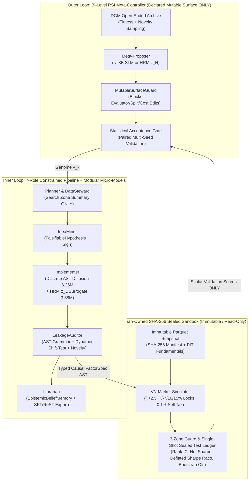

<div align="center">

# VN-RSI: Leak-Free Recursively Self-Improving Multi-Agent Research System for Vietnamese Equities

[](https://www.python.org/)
[](LICENSE)
[](pyproject.toml)
[](pyproject.toml)
[](tests/)
[](notebooks/train_vn_rsi_colab_kaggle.ipynb)
[](#research--safety-disclaimer)

**Author**: **Tran Duy Khang** — *AI Software Engineer / Freelance Vibe Researcher* ([@KenyaWashed](https://github.com/KenyaWashed))

*Can small open models ($\le$8B) — or a decomposed sub-10M **Modular Micro-RSI** core (`HRM/TRM` + `Discrete Masked AST Diffusion`) — recursively improve their own quantitative research policy inside a tamper-proof, leak-free sandbox for a rule-constrained emerging equity market (Vietnam: HOSE, HNX, UPCoM)?*

</div>

---

## Research & Safety Disclaimer

> **IMPORTANT**: This repository is an **academic ML research & simulation framework ONLY** (targeting arXiv `cs.AI` / `cs.LG` / `q-fin.CP`).
> - **Zero live trading**: Contains no brokerage integrations, order routing, trading account credentials, or financial/investment advice.
> - **Offline snapshots only**: Experiments read exclusively from SHA-256 verified local Parquet snapshots (`data/` is gitignored; raw broker data is never redistributed).
> - **Transparent reporting**: Default CI/reproduction tables are clearly flagged `is_synthetic=true` (deterministic Vietnamese microstructure benchmark) until you freeze your own empirical `vnstock` snapshot locally.

---

## Why VN-RSI?

Frontier Recursively Self-Improving (RSI) systems like **AQuA** (`arXiv:2608.12841`), **AIDE²** (`arXiv:2609.26457`), **Darwin Gödel Machine** (`arXiv:2505.22954`), and **ShinkaEvolve** (`arXiv:2509.19349`) rely heavily on massive closed models or multi-GPU clusters, and are typically evaluated on liquid US/crypto datasets. **VN-RSI** brings verifiable, leak-free RSI to **consumer laptops and free cloud GPUs (Kaggle `T4 x2` / Colab `T4`)** under real emerging-market microstructure constraints:

- **SHA-256 Sealed Sandbox (`EvaluatorSeal`)**: Splits, cost simulator, and evaluator are human-owned, hash-pinned, and read-only inside Docker (`--network=none`). Any agent tamper attempt raises `TamperDetectedError`.
- **Single-Shot Sealed Test Ledger (`SealedTestLedger`)**: Strict 3-zone protocol (`search` $\to$ `validation` scalar-only $\to$ `sealed_test` scored **at most once** per frozen config hash).
- **Vietnamese Equity Microstructure (`configs/market_rules.yaml`)**: Enforces **T+2.5 settlement holding locks**, **$\pm 7\%$ (HOSE) / $\pm 10\%$ (HNX) / $\pm 15\%$ (UPCoM) ceiling/floor execution blocks**, 100-share board lots, long-only cash rules, 0.15% brokerage fee, **0.10% statutory sell tax**, square-root ADV illiquidity impact, delisted/halted tickers, and **point-in-time (PIT) fundamental announcement lags**.
- **Two Interchangeable Agent Architectures ($\le$8B Hard Limit)**:
  1. **Monolithic $\le$8B Bi-Level RSI** (`Qwen3-8B` via Ollama/vLLM/llama.cpp + typed causal AST DSL + `EpistemicBeliefMemory` + `DGMArchive`).
  2. **Modular Micro-RSI (Free-GPU Friendly)**: Decomposes the 8B monolith into **3 specialized models**:
     - `Qwen3-4B` / `Qwen3-1.7B` (Unsloth 4-bit QLoRA, ~2.0–4.5 GB VRAM) — Financial Ideation & Critique
     - **Discrete Masked AST Diffusion (`6.36M` params, ~129 MB VRAM)** — 100% grammar-valid causal factor synthesis, **Subtree Infilling** mutation, and Reward-Weighted ReST weight updates
     - **HRM / TRM Hierarchical Recursive Reasoner (`3.38M` params, ~76 MB VRAM)** — Slow ($z_H$) regime planning + Fast ($z_L$) candidate IC surrogate filtering
- **Audited Paper Pipeline**: Auto-generates LaTeX tables from JSONL logs where every single cell links to a `run_id`, verified automatically by `paper/verify_paper.py` (19/19 BibTeX citations, 66/66 numeric cells).

---

## System Architecture



---

## Benchmark Snapshot (Verified Reproduction)

Results below are auto-generated from [`logs/experiment_registry.jsonl`](paper/tables/main_results.tex) on the deterministic Vietnamese microstructure benchmark (`is_synthetic=true`, 30 tickers incl. delisted/halted `ROS_DELIST` & `FLC_HALT`, 2019–2025, net of T+2.5, fees, 0.1% sell tax, and illiquidity slippage):

| Method | Val Rank IC | Val Net Sharpe | Sealed Test Rank IC | Sealed Test Net Sharpe | Test Ann. Net Ret | Test DSR |
| :--- | :---: | :---: | :---: | :---: | :---: | :---: |
| VN-Index Buy & Hold | 0.0000 | 0.506 | 0.0000 | 1.248 | 86.0% | 0.937 |
| Equal-Weight Universe | 0.0000 | 0.454 | 0.0000 | 1.195 | 68.3% | 0.534 |
| Momentum (20d) | 0.0514 | 0.462 | 0.0551 | 1.179 | 54.0% | 0.498 |
| Short-Term Reversal (5d) | -0.0087 | -0.408 | -0.0580 | 0.366 | 15.4% | 0.143 |
| Purged Walk-Forward Ridge | 0.1026 | 0.702 | 0.0781 | 0.327 | 8.7% | 0.121 |
| Purged Walk-Forward GBDT | 0.0787 | 0.615 | 0.0427 | 0.532 | 17.5% | 0.168 |
| Purged Temporal GRU | 0.0976 | 0.450 | 0.0720 | 0.396 | 11.5% | 0.120 |
| Agent $v_0$ ($\le$8B, No RSI) | 0.1036 | 0.677 | 0.0910 | 1.339 | 40.1% | 0.365 |
| **VN-RSI $v^*$ ($\le$8B Bi-Level)** | 0.1025 | 0.877 | 0.0637 | 1.432 | 38.8% | 0.105 |
| **Modular Micro-RSI (`HRM + AST Diff.`)** | **0.1045** | **1.019** | 0.0539 | **1.918** | 31.0% | **0.389** |

> *Why Deflated Sharpe Ratio (DSR) matters*: Notice how accounting for all search & ablation trials lowers DSR relative to naive single-trial Sharpe — illustrating why multiple-testing correction is mandatory in autonomous quant research papers.

---

## Quickstart

### 1. Local Setup (CPU Laptop or Local GPU)

```bash
git clone https://github.com/KenyaWashed/VN_Trading_Agents.git
cd VN_Trading_Agents

# Recommended: fast reproducible install via uv (https://docs.astral.sh/uv/)
uv sync --extra dev

# Or via standard pip
pip install -e ".[dev]"
```

Run the full automated test suite (anti-leakage shift tests, PIT announcement checks, AST causality, SHA-256 tamper seal, single-shot test ledger, $\le$8B guard, and modular model tests):

```bash
uv run python scripts/ci_check.py
```

Run the entire Phases 1 $\to$ 5 research pipeline and verify paper tables:

```bash
uv run python experiments/run_data.py
uv run python experiments/run_baselines.py --reset-ledger
uv run python experiments/run_agent_v0.py
uv run python experiments/run_rsi.py
uv run python experiments/run_modular_rsi.py --preset cpu_fast
uv run python experiments/build_report.py
uv run python paper/verify_paper.py
```

### 2. Free Cloud GPU Training (Kaggle `T4 x2` & Google Colab `T4` — $0)

| Cloud Platform | Free Hardware | Peak VRAM (`Qwen3-4B` + `6.36M Diff` + `3.38M HRM`) | Status |
| :--- | :--- | :---: | :---: |
| **Kaggle Notebooks Free** *(Best)* | Dual NVIDIA T4 (`2 x 16 GB`, 30h/week) | `cuda:0` ~4.5 GB / `cuda:1` ~0.21 GB | **Fully Supported** |
| **Google Colab Free** | Single NVIDIA T4 (`16 GB`) | ~7.2 GB / 16 GB (sequential cleanup) | **Fully Supported** |

- **Notebook**: Upload [`notebooks/train_vn_rsi_colab_kaggle.ipynb`](notebooks/train_vn_rsi_colab_kaggle.ipynb) to Kaggle (`GPU T4 x2`) or Google Colab (`T4 GPU`) and click **Run All**.
- **CLI Script**:
  ```bash
  pip install -q -e ".[dev]" unsloth trl datasets bitsandbytes accelerate
  python train_colab_kaggle.py \
      --preset kaggle_t4_optimal \
      --enable-unsloth-qlora \
      --slm-model unsloth/Qwen3-4B-bnb-4bit \
      --epochs 25 \
      --outer-iters 4
  ```
  *(Use `--slm-model unsloth/Qwen3-1.7B-bnb-4bit` on Colab 1x T4 for ~2x faster iterations.)*

### 3. Isolated Docker Sealed Sandbox (`--network=none`)

```bash
docker build -t vn-rsi-sandbox .
docker run --rm --network=none --read-only --tmpfs /tmp -v "$(pwd)/logs:/workspace/logs" vn-rsi-sandbox
```

---

## Repository Layout & Trust Boundaries

Every source module declares its trust level in its local `README.md`:

| Path | Trust Level | Responsibility |
| :--- | :--- | :--- |
| `configs/` | **HUMAN-OWNED IMMUTABLE** | Market rules, zone dates, $\le$8B budgets, mutable-surface whitelist, Kaggle/Colab presets |
| `src/vn_rsi/data/` | **HUMAN-OWNED IMMUTABLE** | `DataProvider` (`vnstock` + synthetic VN fixture), SHA-256 Parquet snapshots, `DataQASuite` |
| `src/vn_rsi/dsl/` | **HUMAN-OWNED IMMUTABLE** | Fixed causal operator registry (`18` ops, `18` terminals), `ASTVerifier`, JSON schema |
| `src/vn_rsi/sandbox/` | **HUMAN-OWNED IMMUTABLE** | `EvaluatorSeal`, 3-zone `DataZoneGuard`, `VNPortfolioSimulator`, `SealedTestLedger` |
| `src/vn_rsi/eval/` | **HUMAN-OWNED IMMUTABLE** | Rank IC, ICIR, Net Sharpe/Sortino, DSR, block-bootstrap CIs, 7 human baselines, Canary checks |
| `src/vn_rsi/llm/` | **HUMAN-OWNED IMMUTABLE** | `LLMBackend` ($\le$8B enforcement, Ollama/vLLM/llama.cpp, flagged optional teacher) |
| `src/vn_rsi/memory/` | **HYBRID (SCHEMA IMMUTABLE)** | `EpistemicBeliefMemory` with confidence decay, run-ID links, contradiction penalties |
| `src/vn_rsi/agents/` | **AGENT-MUTABLE VIA GENOME** | 7-role constrained hypothesis-to-experiment multi-agent pipeline |
| `src/vn_rsi/models/` | **SEARCH-ZONE TRAINABLE** | `ASTVocab`, `DiscreteASTDiffusion`, `HRMReasoner`, `ModularMicroRSIBackend` |
| `src/vn_rsi/rsi/` | **HUMAN-OWNED META-CONTROLLER** | `BiLevelRSIRunner`, `MutableSurfaceGuard`, `DGMArchive`, statistical gate, Ignition & OOD |
| `experiments/` | **HUMAN-OWNED CLI** | Reproducible experiment runners (`run_data`, `run_baselines`, `run_agent_v0`, `run_rsi`, `run_modular_rsi`, `build_report`) |
| `paper/` | **AUTO-VERIFIED MANUSCRIPT** | LaTeX draft (`main.tex`), verified BibTeX (`references.bib`), generated tables, `verify_paper.py` |
| `tests/` | **HUMAN-OWNED CI** | 21 mandatory leakage, causality, tamper-seal, budget, and modular-model tests |

---

## Documentation Index

- **[MODULAR_RSI_ARCHITECTURE.md](MODULAR_RSI_ARCHITECTURE.md)** — Deep dive into the 3-model decomposition (`Qwen3-4B/1.7B` + `6.36M Discrete AST Diffusion` + `3.38M HRM/TRM`), VRAM calibration, and Kaggle/Colab setup.
- **[REPORT_TONG_HOP_VN_RSI.md](REPORT_TONG_HOP_VN_RSI.md)** — Comprehensive Vietnamese project report covering Phases 0–5 and empirical analysis.
- **[docs/related_work.md](docs/related_work.md)** — Verified literature survey of 17 arXiv papers + 2 foundational quant methodology works.
- **[docs/design_decision.md](docs/design_decision.md)** — Big-to-$\le$8B scaling trade-offs and 5 ranked paper contributions.
- **[docs/data_terms.md](docs/data_terms.md)** — Data source inventory, licensing terms, and offline snapshot reproduction guide.
- **[docs/scale_up_guide.md](docs/scale_up_guide.md)** — Scaling from CPU $\to$ Free T4 $\to$ 24 GB GPU (`Ollama`/`vLLM`) $\to$ multi-GPU & full HOSE/HNX/UPCoM universe.
- **[PROGRESS.md](PROGRESS.md)** — Phase acceptance checklist and transparent Verified vs. UNVERIFIED inventory.

---

## Citation

If you build upon this codebase or sealed emerging-market benchmark in your research, please cite:

```bibtex
@misc{tran2026vnrsi,
  title        = {VN-RSI: Leak-Free Bi-Level Recursive Self-Improvement of Modular Small-Model Quantitative Research Agents in Rule-Constrained Emerging Equities},
  author       = {Tran Duy Khang},
  year         = {2026},
  howpublished = {\url{https://github.com/KenyaWashed/VN_Trading_Agents}},
  note         = {AI Software Engineer / Freelance Vibe Researcher}
}
```

## License

Released under the **MIT License**. Note that raw third-party market data is **not** included or redistributed in this repository; see [`docs/data_terms.md`](docs/data_terms.md).
