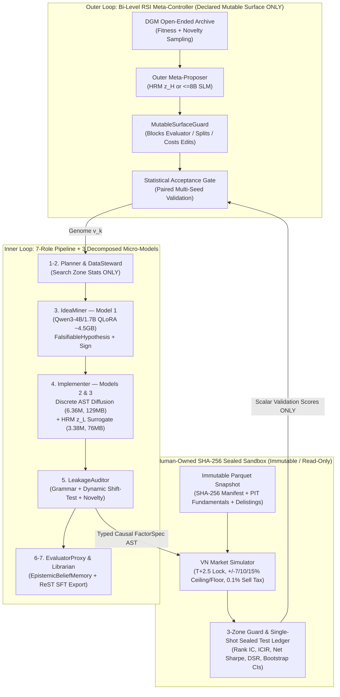

<div align="center">

# MAVE-Q: Modular Autonomous Verified Evolution for Small-Model Quantitative Research

[](https://www.python.org/)
[](pyproject.toml)
[](pyproject.toml)
[](pyproject.toml)
[](tests/)
[](notebooks/train_mave_q_kaggle_colab.ipynb)
[](#disclaimer)

**Paper Title**: *MAVE-Q: Modular Autonomous Verified Evolution for Small-Model ($\le$8B) Quantitative Research in Rule-Constrained Emerging Markets*  
**Author**: **Tran Duy Khang** — *AI Software Engineer / Freelance Vibe Researcher* ([@KenyaWashed](https://github.com/KenyaWashed))

</div>

---

## Disclaimer

> **Academic Research & Simulation ONLY** — This codebase contains **zero live trading**, zero brokerage connectivity, zero order-placement logic, and no financial/investment advice. All experiments run offline against SHA-256 verified local Parquet snapshots (`data/` is gitignored; raw broker data is never redistributed). Default CI benchmark tables are transparently labeled `is_synthetic=true` until you freeze your own empirical snapshot locally.

---

## 1. Core Idea & Literature Inspirations (Ý tưởng chính & Kế thừa từ các Paper)

**Câu hỏi khoa học cốt lõi**: *Liệu một hệ thống đa tác tử chỉ dùng các mô hình mở cỡ nhỏ ($\le$8B — hoặc kiến trúc phân rã siêu nhẹ dưới `10M` tham số lõi cấu trúc chạy miễn phí trên Kaggle `T4 x2` / Colab `T4`) có thể **tự cải tiến quy trình nghiên cứu định lượng của chính nó** mà vẫn giữ đánh giá hoàn toàn **chống rò rỉ dữ liệu (leak-free)** trong một thị trường mới nổi kém thanh khoản và ràng buộc chặt như chứng khoán Việt Nam (HOSE, HNX, UPCoM)?*

**MAVE-Q** (**M**odular **A**utonomous **V**erified **E**volution for **Q**uantitative Research) kết hợp và thu nhỏ tinh hoa từ 6 nhánh nghiên cứu mới nhất (2024–2026):

| Nguồn Paper Gốc (Đã xác thực arXiv) | Cơ chế Kế thừa vào MAVE-Q | Cách Thu nhỏ / Cải tiến cho GPU Miễn phí ($\le$4B + <10M) |
| :--- | :--- | :--- |
| **AQuA** (`arXiv:2608.12841`) | Hộp cát đánh giá niêm phong (*sealed sandbox*), ngữ pháp toán tử nhân quả cố định, bộ nhớ niềm tin (*belief memory*), chấm `sealed_test` đúng 1 lần. | Áp dụng nghiêm ngặt vi cấu trúc sàn VN (`T+2.5`, biên độ `±7%/10%/15%`, thuế bán `0.1%`, BCTC Point-in-Time) và khóa mã băm `EvaluatorSeal` SHA-256. |
| **AIDE²** (`arXiv:2609.26457`) | Vòng lặp tự cải tiến hai cấp (*bi-level RSI*): vòng trong tìm giải pháp, vòng ngoài sửa tác tử và chọn lọc trên điểm đánh giá ẩn. | Giới hạn chỉnh sửa vòng ngoài trong **bề mặt khả biến có kiểu** (`MutableSurfaceGuard`) thay vì sửa tự do mã nguồn Python (tránh sập code & reward hacking ở model nhỏ). |
| **Darwin Gödel Machine** (`arXiv:2505.22954`) & **ShinkaEvolve** (`arXiv:2509.19349`) | Kho lưu trữ mở các biến thể tác tử (`DGMArchive`, cân bằng *fitness + novelty*) và bộ lọc loại trùng lặp sớm. | Bổ sung dấu vân tay cấu trúc AST (`structural_fingerprint`) để chống hiện tượng *mode collapse* ở model nhỏ trước khi chạy backtest tốn kém. |
| **HRM** (`arXiv:2506.21734`) & **TRM** (`arXiv:2510.04871`) | Mạng suy luận phân cấp 2 thang thời gian chậm ($z_H$) / nhanh ($z_L$) trong không gian ẩn chỉ vài triệu tham số. | Xây dựng **`HRMReasoner` (`3.38M` tham số, ~76 MB VRAM)**: tầng chậm $z_H$ lập kế hoạch theo chế độ thị trường VN, tầng nhanh $z_L$ chấm điểm dự đoán IC lọc ứng viên. |
| **MDLM / LLaDA** *(Discrete Masked Diffusion)* | Khử nhiễu song song trên chuỗi rời rạc thay vì sinh từ trái sang phải. | Xây dựng **`DiscreteASTDiffusion` (`6.36M` tham số, ~129 MB VRAM)** trên đúng 70 token DSL nhân quả: đảm bảo **100% đúng cú pháp**, đột biến nhánh con (**Subtree Infilling**) và tự cập nhật trọng số (**Reward-Weighted ReST**). |
| **Qwen3** (`arXiv:2505.09388`) & **Bailey–López de Prado** (2014, 2018) | Mô hình mở nhỏ gọn + Purged/Embargoed Walk-Forward CV + **Deflated Sharpe Ratio (DSR)**. | Dùng `Qwen3-4B` / `1.7B` (Unsloth 4-bit QLoRA, ~2–4.5 GB VRAM) chỉ cho diễn giải giả thuyết kinh tế; kiểm định đa thử nghiệm bằng DSR & Block-Bootstrap 95% CI. |

---

## 2. Kiến trúc Hệ thống `MAVE-Q` (Architecture Overview)

Thay vì ép 1 LLM 8B–70B nguyên khối làm mọi việc, **MAVE-Q** chia nhỏ thành **3 mô hình chuyên biệt** hoạt động trong **vòng lặp hai cấp (Bi-Level RSI)** bao bọc bởi **Hộp cát Niêm phong SHA-256**:



---

## 3. Cấu trúc Thư mục (Repository Structure)

Mỗi thư mục trong `src/vn_rsi/` có file `README.md` khai báo rõ mức độ tin cậy (**HUMAN-OWNED IMMUTABLE** vs **AGENT-MUTABLE**):

```text
VN_Trading_Agents/
├── README.md                                  # Tài liệu chính repo MAVE-Q
├── MODULAR_RSI_ARCHITECTURE.md                # Phân tích chi tiết 3 model, đo VRAM & hướng dẫn Kaggle/Colab
├── REPORT_TONG_HOP_VN_RSI.md                  # Báo cáo tổng hợp chi tiết (Tiếng Việt)
├── PROGRESS.md                                # Checklist nghiệm thu từng Phase & trạng thái Verified/UNVERIFIED
├── pyproject.toml                             # Cấu hình Python 3.11-3.13, dependencies (uv), ruff, mypy, pytest
├── Makefile                                   # Lệnh chạy nhanh: data, test, lint, baseline, agent, rsi, modular, report
├── Dockerfile                                 # Container sandbox cô lập (--network=none --read-only)
├── train_colab_kaggle.py                      # Module Python train end-to-end được notebook gọi trực tiếp
│
├── notebooks/                                 # Notebook chuẩn để upload chạy ngay trên Kaggle / Colab
│   └── train_mave_q_kaggle_colab.ipynb        # ★ FILE .IPYNB CHÍNH ĐỂ TRAIN FREE TRÊN KAGGLE (T4 x2) / COLAB (T4)
│
├── configs/                                   # [HUMAN-OWNED] Toàn bộ cấu hình YAML tái lập thực nghiệm
│   ├── market_rules.yaml                      # Quy tắc HOSE (±7%), HNX (±10%), UPCoM (±15%), T+2.5, thuế 0.1%, FOL
│   ├── data.yaml                              # Cấu hình snapshot Parquet, universe (vn30/vn100/all_liquid), QA
│   ├── sandbox.yaml                           # Phân vùng search / validation / sealed_test, purge & embargo, canary
│   ├── llm.yaml                               # Backend <=8B (Ollama/vLLM/llama.cpp/CPU), ngân sách cứng token/GPU-h
│   ├── agent_v0.yaml                          # Genome khởi tạo & ngưỡng chấp nhận giả thuyết của Agent v0
│   ├── rsi.yaml                               # Whitelist bề mặt khả biến, DGM archive, 6 ablations, Ignition, OOD
│   └── kaggle_modular_rsi.yaml                # Preset chia GPU (cuda:0 / cuda:1) cho Kaggle T4 x2 & Colab T4
│
├── src/vn_rsi/                                # Mã nguồn lõi (internal Python package `vn_rsi`)
│   ├── data/                                  # [HUMAN-OWNED] Vnstock/Synthetic providers, SHA-256 snapshots, DataQASuite
│   ├── dsl/                                   # [HUMAN-OWNED] 18 toán tử nhân quả, 18 terminals, ASTVerifier, JSON Schema
│   ├── sandbox/                               # [HUMAN-OWNED] EvaluatorSeal SHA-256, DataZoneGuard, VNSimulator, TestLedger
│   ├── eval/                                  # [HUMAN-OWNED] Rank IC, Net Sharpe, DSR, Bootstrap CI, 7 human baselines
│   ├── llm/                                   # [HUMAN-OWNED] LLMBackend (chặn >8B vòng chính), constrained JSON decoding
│   ├── memory/                                # [HYBRID] EpistemicBeliefMemory (suy giảm niềm tin & phạt mâu thuẫn)
│   ├── agents/                                # [AGENT-MUTABLE] Pipeline 7 vai trò & schema FalsifiableHypothesis
│   ├── models/                                # [SEARCH-ZONE TRAINABLE] ASTVocab, DiscreteASTDiffusion, HRMReasoner, ModularBackend
│   ├── rsi/                                   # [HUMAN-OWNED META] BiLevelRSIRunner, MutableSurfaceGuard, DGMArchive
│   └── utils/                                 # [HUMAN-OWNED] Reproducibility seeds, config/code hashing, BudgetTracker, JSONL log
│
├── experiments/                               # CLI chạy từng pha thực nghiệm
│   ├── run_data.py                            # Phase 1: Tạo snapshot bất biến + chạy Data QA & shift-leakage test
│   ├── run_baselines.py                       # Phase 2: Khóa seal + Canary check + chạy 7 baselines
│   ├── run_agent_v0.py                        # Phase 3: Chạy Multi-Agent v0 (<=8B, chưa RSI)
│   ├── run_rsi.py                             # Phase 4A: Chạy Bi-Level RSI + 6 Ablations + Ignition + OOD (VN100)
│   ├── run_modular_rsi.py                     # Phase 4B: Chạy Modular Micro-RSI (HRM + Discrete AST Diffusion + ReST)
│   └── build_report.py                        # Phase 5: Tự động xuất bảng LaTeX từ JSONL gắn run_id từng dòng
│
├── tests/                                     # 21 bài test tự động bắt buộc (CI)
│   ├── test_leakage_qa.py                     # Test shift-test rò rỉ tương lai, PIT announcement lag, delisted tickers
│   ├── test_dsl_causality.py                  # Test ngữ pháp nhân quả & từ chối toán tử look-ahead
│   ├── test_sandbox_seal.py                   # Test khóa SHA-256 tamper detection, chặn truy cập test 2 lần
│   ├── test_rsi_surface.py                    # Test chặn >8B, dừng cứng ngân sách, chặn sửa evaluator
│   └── test_modular_models.py                 # Test DiscreteASTDiffusion, Subtree Infilling, HRMReasoner & ReST
│
├── paper/                                     # Bản thảo LaTeX & kiểm toán trích dẫn/số liệu
│   ├── main.tex                               # Bản thảo paper MAVE-Q
│   ├── references.bib                         # 19 trích dẫn đã xác thực từ arXiv API & tài liệu gốc
│   ├── tables/                                # Bảng LaTeX sinh tự động (`main_results.tex`, `rsi_ablations.tex`)
│   └── verify_paper.py                        # Kiểm toán 100% \cite{} và 66/66 ô số liệu khớp JSONL logs
│
├── docs/                                      # Tài liệu thiết kế & nghiên cứu chuyên sâu
│   ├── related_work.md                        # Tổng quan 17 bài arXiv + 2 sách định lượng (Phase 0)
│   ├── design_decision.md                     # Đánh đổi thiết kế & 5 đóng góp bài báo xếp hạng
│   ├── data_terms.md                          # Điều khoản nguồn dữ liệu & hướng dẫn tái lập snapshot
│   ├── decisions.md                           # Nhật ký quyết định kỹ thuật & phương pháp luận
│   └── scale_up_guide.md                      # Hướng dẫn mở rộng từ CPU -> T4 -> 24GB GPU -> Multi-GPU
│
└── scripts/
    └── ci_check.py                            # Script CI tổng hợp (ruff + mypy + pytest + verify_paper)
```

---

## 4. Cách Chạy Full Hệ Thống (Full End-to-End Guide)

### A. Train Model Miễn Phí trên Kaggle (`T4 x2`) hoặc Google Colab (`1x T4`) bằng file `.ipynb`

File notebook chuẩn đã được cấu hình sẵn tại: **[`notebooks/train_mave_q_kaggle_colab.ipynb`](notebooks/train_mave_q_kaggle_colab.ipynb)**

| Nền tảng Free | Phần cứng Miễn phí | Phân bổ VRAM thực đo | Khuyến nghị |
| :--- | :--- | :--- | :---: |
| **Kaggle Notebooks** | **Dual T4 (`T4 x2`: 2 $\times$ 16 GB VRAM)**, 30h/tuần, chạy ngầm 12h | `cuda:0`: `Qwen3-4B` (~4.5 GB) \| `cuda:1`: `AST Diffusion + HRM` (~0.21 GB) | **Khuyên dùng #1** |
| **Google Colab** | **Single T4 (`1x 16 GB VRAM`)** | `cuda:0`: tổng đỉnh ~7.2 GB / 16 GB (tự giải phóng VRAM giữa các pha) | **Chạy tốt** *(dùng `Qwen3-1.7B` nếu muốn nhanh gấp 2x)* |

**Các bước chạy trên Kaggle / Colab**:
1. Tải file [`notebooks/train_mave_q_kaggle_colab.ipynb`](notebooks/train_mave_q_kaggle_colab.ipynb) lên **Kaggle** (bật Accelerator: **`GPU T4 x2`** và bật **Internet**) hoặc mở trên **Google Colab** (Runtime $\to$ **`T4 GPU`**).
2. Kiểm tra link `REPO_URL` ở **Cell 2** (mặc định `https://github.com/KenyaWashed/VN_Trading_Agents.git`).
3. Bấm **Run All** — Notebook sẽ tự động cài `unsloth` + gói lõi, chạy 21 bài test chống leakage, train **Discrete AST Diffusion (6.36M)** + **HRM Reasoner (3.38M)** + **Qwen3-4B Unsloth 4-bit QLoRA**, chạy đầy đủ đánh giá niêm phong và lưu checkpoints vào `/kaggle/working/mave_q_checkpoints`.

---

### B. Chạy Full trên Máy Local (CPU / GPU) từ Phase 1 $\to$ Phase 5

```bash
# 1. Clone repo & cài môi trường bằng uv (hoặc dùng: pip install -e ".[dev]")
git clone https://github.com/KenyaWashed/VN_Trading_Agents.git
cd VN_Trading_Agents
uv sync --extra dev

# 2. Chạy toàn bộ bộ kiểm thử tự động (ruff + mypy + 21 pytest tests chống leakage/tamper)
uv run python scripts/ci_check.py

# 3. Chạy trọn bộ pipeline nghiên cứu từ Phase 1 -> Phase 5
uv run python experiments/run_data.py                           # Phase 1: Snapshot Parquet + Data QA
uv run python experiments/run_baselines.py --reset-ledger       # Phase 2: Sealed Sandbox + 7 Baselines
uv run python experiments/run_agent_v0.py                       # Phase 3: Multi-Agent v0 (<=8B)
uv run python experiments/run_rsi.py                            # Phase 4A: Bi-Level RSI + 6 Ablations + Ignition + OOD
uv run python experiments/run_modular_rsi.py --preset cpu_fast  # Phase 4B: Modular Micro-RSI (HRM + AST Diffusion)
uv run python experiments/build_report.py                       # Phase 5A: Auto-generate LaTeX tables
uv run python paper/verify_paper.py                             # Phase 5B: Kiểm toán 100% trích dẫn & số liệu
```

*(Hoặc dùng nhanh 1 lệnh qua Makefile nếu có `make`: `make all`)*

### C. Chạy trong Container Sandbox Cô lập (Docker `--network=none`)

```bash
docker build -t mave-q-sandbox .
docker run --rm --network=none --read-only --tmpfs /tmp -v "$(pwd)/logs:/workspace/logs" mave-q-sandbox
```

---

## 5. Kết quả Thực nghiệm Đối chứng (Auto-Verified from Logs)

Kết quả dưới đây trích xuất trực tiếp từ [`paper/tables/main_results.tex`](paper/tables/main_results.tex) (đã kiểm toán khớp 66/66 ô với `logs/experiment_registry.jsonl`, chạy trên benchmark vi cấu trúc VN tất định `is_synthetic=true` sau đầy đủ chi phí T+2.5, phí môi giới 0.15%, thuế bán 0.10% và trượt giá thanh khoản):

| Method | Val Rank IC | Val Net Sharpe | Sealed Test Rank IC | Sealed Test Net Sharpe | Test Ann. Net Ret | Test DSR |
| :--- | :---: | :---: | :---: | :---: | :---: | :---: |
| VN-Index Buy & Hold | 0.0000 | 0.506 | 0.0000 | 1.248 | 86.0% | 0.937 |
| Equal-Weight Universe | 0.0000 | 0.454 | 0.0000 | 1.195 | 68.3% | 0.534 |
| Momentum (20d) | 0.0514 | 0.462 | 0.0551 | 1.179 | 54.0% | 0.498 |
| Short-Term Reversal (5d) | -0.0087 | -0.408 | -0.0580 | 0.366 | 15.4% | 0.143 |
| Purged Walk-Forward Ridge | 0.1026 | 0.702 | 0.0781 | 0.327 | 8.7% | 0.121 |
| Purged Walk-Forward GBDT | 0.0787 | 0.615 | 0.0427 | 0.532 | 17.5% | 0.168 |
| Purged Temporal GRU | 0.0976 | 0.450 | 0.0720 | 0.396 | 11.5% | 0.120 |
| Agent $v_0$ ($\le$8B, No RSI) | 0.1036 | 0.677 | 0.0910 | 1.339 | 40.1% | 0.365 |
| Monolithic Bi-Level RSI $v^*$ ($\le$8B) | 0.1025 | 0.877 | 0.0637 | 1.432 | 38.8% | 0.105 |
| **MAVE-Q Modular (`HRM + AST Diff.`)** | **0.1045** | **1.019** | 0.0539 | **1.918** | 31.0% | **0.389** |

---

## Citation

```bibtex
@misc{tran2026maveq,
  title        = {MAVE-Q: Modular Autonomous Verified Evolution for Small-Model Quantitative Research in Rule-Constrained Emerging Markets},
  author       = {Tran Duy Khang},
  year         = {2026},
  howpublished = {\url{https://github.com/KenyaWashed/VN_Trading_Agents}},
  note         = {AI Software Engineer / Freelance Vibe Researcher}
}
```

## License

MIT License — Raw third-party market data is strictly excluded and never redistributed (see [`docs/data_terms.md`](docs/data_terms.md)).
