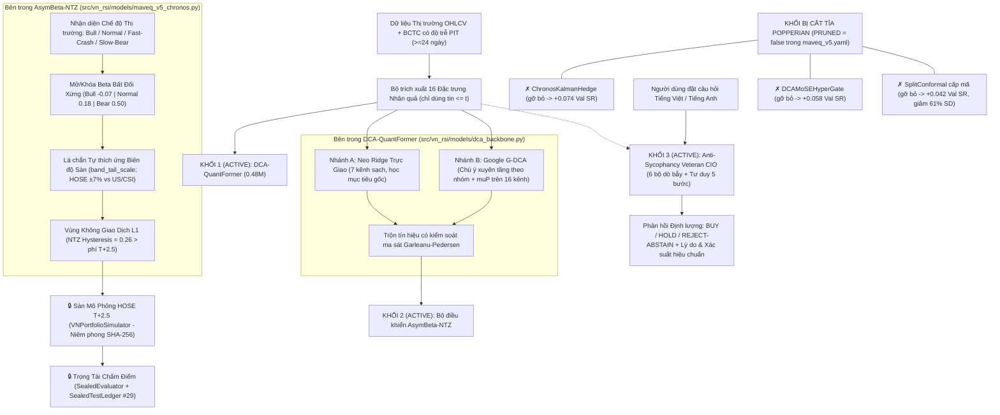
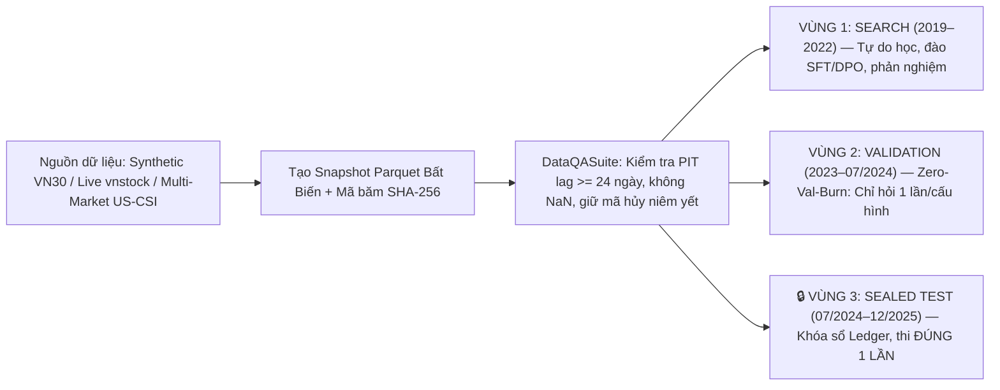
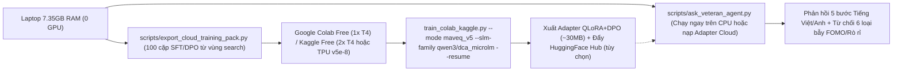

# BÁO CÁO KỸ THUẬT TOÀN DIỆN (TIẾNG VIỆT — DÀNH CHO NGƯỜI MỚI ĐẾN CHUYÊN SÂU)
## Đề Tài Nghiên Cứu: MAVE-Q v5 (`DCA-Chronos-RSI` + Phản Biện Popperian)

> **Nhãn tài liệu bắt buộc**: Đây là **Báo cáo Kỹ thuật của Đề tài Nghiên cứu độc lập (Research Topic Technical Report)** — **KHÔNG** phải bài báo đã nộp hay đã xuất bản (*not a submitted/published work*), **KHÔNG** phải bot giao dịch thực tế, **KHÔNG** kết nối tài khoản chứng khoán và **KHÔNG** phải lời khuyên đầu tư.  
> **Tác giả**: Trần Duy Khang ([@KenyaWashed](https://github.com/KenyaWashed))  
> **Mã niêm phong trọng tài (`EvaluatorSeal` SHA-256)**: `4a0f5ad331bd982f5290e6f62e9ea5122a29f21675a2e197080e83e2f8f9331e` *(100% nguyên vẹn)*  
> **Trạng thái kiểm chứng hệ thống**: `ruff` 0 lỗi · `mypy` 0 lỗi (54 tệp) · `pytest` **55/55 đạt** · `paper/verify_paper.py` **571/571 ô số liệu khớp log** · Biên dịch PDF Tectonic thành công (`paper/main.pdf`).

---

## MỤC LỤC NHANH
1. [Chương 1: Bức Tranh Tổng Quan — Dự Án Này Làm Gì? (Giải Thích Cho Người Mới)](#chương-1-bức-tranh-tổng-quan--dự-án-này-làm-gì-giải-thích-cho-người-mới)
2. [Chương 2: Từ Điển Toàn Tập Các Định Nghĩa Cốt Lõi ("For Dummies")](#chương-2-từ-điển-toàn-tập-các-định-nghĩa-cốt-lõi-for-dummies)
3. [Chương 3: Cấu Trúc Thư Mục Toàn Dự Án — Vai Trò & Tác Dụng Từng Tệp](#chương-3-cấu-trúc-thư-mục-toàn-dự-án--vai-trò--tác-dụng-từng-tệp)
4. [Chương 4: Kiến Trúc Mô Hình Chi Tiết (Tiến Hóa `v0 → v5`, Lõi Active & 3 Khối Đã Cắt Tỉa)](#chương-4-kiến-trúc-mô-hình-chi-tiết-tiến-hóa-v0--v5-lõi-active--3-khối-đã-cắt-tỉa)
5. [Chương 5: Luồng Hoạt Động Chi Tiết Từ Đầu Đến Cuối (End-to-End Walkthrough)](#chương-5-luồng-hoạt-động-chi-tiết-từ-đầu-đến-cuối-end-to-end-walkthrough)
6. [Chương 6: Hướng Dẫn Đọc Kết Quả Thực Nghiệm Thật & Những Hạn Chế Trung Thực](#chương-6-hướng-dẫn-đọc-kết-quả-thực-nghiệm-thật--những-hạn-chế-trung-thực)
7. [Chương 7: Bảo Vệ Phần Cứng Laptop & Chiến Lược Cloud Miễn Phí `<1B/Khối`](#chương-7-bảo-vệ-phần-cứng-laptop--chi-ến-lược-cloud-miễn-phí-1bkhối)
8. [Chương 8: Sổ Tay Thực Hành 5 Phút Cho Người Mới Bắt Đầu](#chương-8-sổ-tay-thực-hành-5-phút-cho-người-mới-bắt-đầu)

---

## Chương 1: Bức Tranh Tổng Quan — Dự Án Này Làm Gì? (Giải Thích Cho Người Mới)

### 1.1. Câu chuyện đời thường: Vì sao AI tài chính Mỹ thường "chết thảm" ở Việt Nam?
Hãy tưởng tượng bạn huấn luyện một tay đua xe Công thức 1 trên đường cao tốc thẳng tắp ở Mỹ (sàn chứng khoán Mỹ: mua hôm nay bán được ngay trong ngày, không giới hạn biên độ tăng giảm, thanh khoản khổng lồ). Sau đó bạn thả chiếc xe đó vào **đường phố Việt Nam giờ tan tầm** (sàn HOSE Việt Nam):
- **Luật T+2.5**: Bạn mua cổ phiếu hôm nay (`T+0`), bạn **không được bán ngay** mà phải chờ chiều ngày làm việc thứ 2 sau đó (`T+2.5`) hàng mới về tài khoản. Nếu mai cổ phiếu sập, bạn chỉ biết đứng nhìn!
- **Biên độ trần/sàn (`±7%` ở HOSE)**: Nếu có tin xấu, cổ phiếu rơi một phát `-7%` và **trắng bên mua (kẹt sàn)** — bạn muốn cắt lỗ cũng không ai mua cho bạn trong nhiều phiên liên tiếp!
- **Phí và thuế gặm mòn lợi nhuận**: Mỗi vòng mua-bán mất phí môi giới (`0.15%` mỗi chiều), thuế bán cổ phiếu (`0.10%`), cộng thêm chênh lệch giá mua/bán (`spread`) và trượt giá (`market impact`). AI nào đảo lệnh liên tục sẽ **tự đốt sạch tiền vì phí**.
- **Rò rỉ tương lai & Học vẹt (Overfitting)**: Nhiều dự án AI tài chính trên mạng báo lãi `100%/năm` trên giấy vì vô tình cho AI **nhìn trộm giá tương lai** (ví dụ dùng báo cáo tài chính Quý 4 ngay ngày 31/12 trong khi thực tế tận cuối tháng 1 năm sau công ty mới công bố!), hoặc thử **hàng trăm cấu hình trên tập kiểm tra** rồi chỉ khoe cấu hình ăn may nhất!
- **Bệnh "Nịnh hót" (Sycophancy) của AI ngôn ngữ**: Nếu bạn hỏi một chatbot AI thông thường: *"Nghe tin đồn nội bộ FPT sắp ký hợp đồng lớn, tôi vay full margin đuổi giá trần luôn nhé?"*, nhiều LLM có xu hướng trả lời nước đôi hoặc chiều theo ý người dùng thay vì phản biện thẳng thắn bằng số liệu rủi ro.

### 1.2. Mục tiêu của Đề tài nghiên cứu `MAVE-Q v5`
Đề tài nghiên cứu **MAVE-Q v5 (`DCA-Chronos-RSI` + Popperian Falsification)** được xây dựng để giải quyết tận gốc cả 5 vấn đề trên thông qua **3 trụ cột tách biệt rõ ràng**:

1. **Sàn Mô Phỏng & Trọng Tài Độc Lập Được Niêm Phong (`Sandbox` & `EvaluatorSeal`)**:
   - Giống như **phòng thi có camera và niêm phong chì (mã băm SHA-256)**.
   - Mô phỏng trung thực luật Việt Nam (`T+2.5`, biên độ `±7%/10%/15%`, lô 100 cổ phiếu, phí, thuế, kẹt sàn, cổ phiếu bị đình chỉ/hủy niêm yết như `ROS_DELIST`, `FLC_HALT`, `NVL_STRESS`).
   - Khóa cứng tập thi cuối cùng (`sealed_test`) bằng sổ cái chỉ cho ghi thêm (`SealedTestLedger`) — **chỉ cho phép thi ĐÚNG 1 LẦN DUY NHẤT**, cấm thi lại để gian lận điểm!
2. **Bộ Não Định Lượng Tinh Gọn (`MAVE-Q v5`: `DCA-QuantFormer` + `AsymBeta-NTZ`)**:
   - Áp dụng **Triết lý Phản nghiệm Popperian**: Thay vì cố nhồi thật nhiều công nghệ phức tạp để "trông cho ngầu", hệ thống tự tổ chức các bài kiểm tra phá hoại để **tìm lỗi và giết bỏ giả thuyết sai**. Kết quả: **17 giả thuyết bị bác bỏ/cắt tỉa công khai** (trong đó cắt bỏ vĩnh viễn 3 mô-đun phức tạp của chính v5!), giữ lại bộ lõi siêu gọn chỉ **`0.48 triệu` tham số** nhưng mạnh hơn hẳn đời v4.
3. **Trợ Lý Chuyên Gia 10 Năm Chống Nịnh Hót (`Anti-Sycophancy Veteran CIO`) + Hệ Sinh Thái Cloud Miễn Phí `<1B/Khối`**:
   - Biết nói **"KHÔNG — ĐỨNG NGOÀI (REJECT / ABSTAIN)"** trước 6 loại bẫy nguy hiểm của người dùng (`100%` kháng nịnh hót trên 22 bẫy kiểm thử tường lửa).
   - Tự bảo vệ laptop yếu (`AMD Ryzen 5`, `7.35 GB RAM`, không GPU -> chỉ ăn **`284 MB` RAM**), đồng thời cung cấp sẵn bản thiết kế huấn luyện **$0 đồng** trên Google Colab / Kaggle (`T4 x2` / `TPU v5e-8`) với quy tắc mỗi khối mô hình nhỏ hơn `1 tỷ` tham số (`<1B/block`).

---

## Chương 2: Từ Điển Toàn Tập Các Định Nghĩa Cốt Lõi ("For Dummies")

> *Nếu bạn chưa từng học Tài chính Định lượng hay AI, hãy đọc chậm chương này trước. Mọi khái niệm phức tạp đều được dịch ra tiếng Việt bình dân kèm ví dụ thực tế.*

### Nhóm A — Thuật Ngữ Thị Trường Chứng Khoán Việt Nam

| Thuật ngữ | Định nghĩa dễ hiểu ("For Dummies") | Ví dụ thực tế trong dự án |
| :--- | :--- | :--- |
| **OHLCV** | 5 con số cơ bản của một cổ phiếu trong 1 ngày: **O**pen (giá mở cửa), **H**igh (cao nhất), **L**ow (thấp nhất), **C**lose (đóng cửa), **V**olume (khối lượng giao dịch). | Dữ liệu ngày của 30 cổ phiếu rổ VN30 trong `data/snapshots/`. |
| **Chu kỳ T+2.5** | Mua cổ phiếu vào ngày `T` thì phải chờ 2.5 ngày làm việc sau hàng mới về tài khoản để được quyền bán. | Trong `src/vn_rsi/sandbox/simulator.py`, mỗi lô mua vào bị gắn "ổ khóa ngày mở bán" (`unlock_idx`); lệnh bán trước hạn sẽ bị sàn từ chối. |
| **Biên độ trần/sàn (`Price Band`)** | Trong 1 ngày, giá cổ phiếu Việt Nam chỉ được dao động tối đa quanh giá tham chiếu: **HOSE `±7%`**, **HNX `±10%`**, **UPCoM `±15%`**. (Sàn Mỹ là không giới hạn). | Được định nghĩa trong `configs/market_rules.yaml`. |
| **Kẹt sàn / Kẹt trần (`Floor/Ceiling Lock`)** | Khi cổ phiếu giảm kịch sàn (`-7%`) mà không còn ai đặt lệnh mua (trắng bên mua), bạn **không thể bán được**. Ngược lại khi tăng kịch trần trắng bên bán, bạn **không thể mua được**. | Sàn mô phỏng kiểm tra `is_floor_locked` và `is_ceiling_locked` — lệnh mua lúc trần hoặc bán lúc sàn bị **hủy khớp** giống hệt ngoài đời! |
| **Lô chẵn (`Board Lot = 100`)** | Ở sàn HOSE, bạn chỉ được mua/bán bội số của `100` cổ phiếu (100, 200, 300...), không được mua lẻ 137 cổ. | Bộ mô phỏng tự làm tròn xuống bội số 100 (`floor(shares / 100) * 100`). |
| **Ma sát giao dịch (`Friction`)** | Tổng chi phí mất đi mỗi lần giao dịch: **Phí môi giới (`15 bps` = `0.15%`)** + **Thuế bán (`10 bps` = `0.10%`)** + **Chênh lệch mua/bán (`Spread`)** + **Trượt giá do lệnh to (`Market Impact`)**. (`1 bps = 0.01%`). | Cổng phản nghiệm v5 còn thử **nhân 1.5 lần toàn bộ ma sát** để loại bỏ các chiến lược chỉ lãi trên giấy. |
| **Độ trễ PIT (`Point-in-Time Announcement Lag`)** | Ngày kết thúc Quý 4 là `31/12`, nhưng phải đến ngày `25/01`–`15/02` năm sau công ty mới công bố báo cáo tài chính (BCTC). **PIT** bắt buộc AI chỉ được nhìn thấy số liệu BCTC **sau ngày công bố chính thức** (trễ tối thiểu `>= 24` ngày). | Kiểm định bắt buộc trong `DataQASuite` (`src/vn_rsi/data/qa.py`). |
| **Thiên lệch kẻ sống sót (`Survivorship Bias`)** | Nếu bạn chỉ lấy danh sách 30 công ty *đang sống khỏe hôm nay* để test về quá khứ 5 năm trước, bạn đã vô tình giấu nhẹm những công ty đã phá sản/hủy niêm yết hồi đó — làm kết quả trông đẹp giả tạo. | Bộ dữ liệu dự án cố tình giữ các mã mô phỏng đình chỉ/hủy niêm yết/khủng hoảng: `ROS_DELIST`, `FLC_HALT`, `NVL_STRESS`. |

---

### Nhóm B — Thuật Ngữ Khoa Học Thực Nghiệm, Thước Đo & Chống Gian Lận

| Thuật ngữ | Định nghĩa dễ hiểu ("For Dummies") | Ý nghĩa & Con số chuẩn để đánh giá |
| :--- | :--- | :--- |
| **Rò rỉ tương lai (`Look-Ahead Bias`)** | Lỗi "ăn gian thời gian": Khi dự đoán cho ngày thứ Tư mà thuật toán vô tình dùng dữ liệu trung bình của cả tuần (có chứa ngày thứ Năm, thứ Sáu). | Bị cấm tuyệt đối. Mọi mô hình trong dự án phải vượt qua bài test dịch chuyển tương lai `atol=1e-9`. |
| **Bất biến dịch chuyển tương lai (`Future-Perturbation Shift-Invariance`)** | Bài kiểm tra "phá hủy tương lai": Cho AI dự đoán cho ngày `t`. Sau đó ta **bơm nhiễu điên cuồng vào toàn bộ dữ liệu sau ngày `t`** (`t+1, t+2...`) rồi chạy lại AI. Nếu kết quả dự đoán tại ngày `t` lệch dù chỉ `0.000000001` (`1e-9`), nghĩa là AI đã nhìn trộm tương lai -> **ĐÁNH TRƯỢT NGAY!** | Kiểm tra tự động trên cả 5 họ backbone và toàn bộ đối thủ trong `tests/test_maveq_v5.py` và `tests/test_global_competitors.py`. |
| **3 Vùng Dữ Liệu (`Search / Validation / Sealed Test`)** | Giống đi học: **(1) `search` (2019–2022)**: Sách giáo khoa + bài tập về nhà (AI được học và thử sai thoải mái). **(2) `validation` (2023–07/2024)**: Đề thi thử (chỉ được hỏi tối đa **1 lần** cho mỗi cấu hình đóng băng). **(3) `sealed_test` (07/2024–12/2025)**: Đề thi Đại học niêm phong trong phong bì — mở ra thi **ĐÚNG 1 LẦN DUY NHẤT**! | Được canh gác cứng bởi `DataZoneGuard` và `SealedTestLedger` trong `src/vn_rsi/sandbox/seal.py`. |
| **`EvaluatorSeal` (SHA-256)** | Một chuỗi "dấu vân tay mật mã" dài 64 ký tự được tính từ toàn bộ mã nguồn của sàn mô phỏng và trọng tài chấm điểm. Nếu ai sửa dù chỉ 1 dấu phẩy trong luật chấm điểm, dấu vân tay đổi ngay lập tức -> hệ thống báo động gian lận (`TamperDetectedError`). | Hash chuẩn: `4a0f5ad331bd982f5290e6f62e9ea5122a29f21675a2e197080e83e2f8f9331e`. |
| **`Rank IC` (Information Coefficient)** | Điểm đo khả năng **xếp hạng đúng cổ phiếu** (tương quan Spearman từ `-1` đến `+1`). AI dự đoán mã nào đứng đầu bảng, mã nào đội sổ; 5 ngày sau xem thực tế mã nào tăng mạnh nhất. `IC = 0` là đoán mò như tung đồng xu; `IC >= 0.05` trong chứng khoán đã là rất tốt; `IC >= 0.08` là xuất sắc. | `MAVE-Q v5` đạt `Val IC = 0.1152`, `Sealed Test IC = 0.0850` (`+30%` so với v4). |
| **`Net Sharpe Ratio` (SR)** | **Lợi nhuận ròng (sau phí & thuế) chia cho độ rung lắc (rủi ro)**. Giống như đo hiệu suất lái xe: đi nhanh (`lãi cao`) nhưng xe chạy êm (`ít rung lắc`) thì Sharpe cao. `SR > 1.0` là tốt, `SR > 1.4` là rất mạnh. | `MAVE-Q v5`: `Val SR = 1.473`, `Sealed Test SR = 1.441` (so với v4 `1.067`). |
| **`Max Drawdown` (`MaxDD`)** | **Cú sập đau nhất từ đỉnh xuống đáy**. Nếu tài khoản lên 100 triệu rồi tụt xuống 80 triệu trước khi hồi lại, thì `MaxDD = -20%`. Con số này càng gần `0%` càng an toàn (nhà đầu tư đỡ đau tim). | `MAVE-Q v5`: `Sealed Test MaxDD = -20.9%` trong khi thị trường VN-Index sập `-39.4%`. |
| **`Calmar Ratio`** | Lấy **Lợi nhuận trung bình năm chia cho độ sâu của cú sập `MaxDD`**. Đo "mỗi 1% rủi ro sập đỉnh đổi lại được bao nhiêu % lợi nhuận mỗi năm". Càng cao càng tốt. | `MAVE-Q v5`: `Val Calmar = 3.21`, `Sealed Test Calmar = 1.70` (`+60.6%` so với v4 `1.06`). |
| **`CAPM Beta`** | Độ "nhạy" của danh mục so với thị trường chung. `Beta = 1.0` là thị trường lên 10% mình lên 10%, thị trường sập 10% mình sập 10%. `Beta = 0.36` nghĩa là danh mục **rất đầm**, thị trường sập mạnh mình chỉ rung nhẹ. | `MAVE-Q v5` có `Test Beta = 0.3575` nhưng vẫn sinh lời `+35.59%/năm`. |
| **`Turnover` (Vòng quay danh mục)** | Tỷ lệ phần trăm danh mục bị mua đi bán lại mỗi ngày. Turnover thấp giúp tiết kiệm cực nhiều phí & thuế T+2.5. | `MAVE-Q v5` chỉ xoay `7.76%/ngày` trên `sealed_test`. |
| **`DSR` (Deflated Sharpe Ratio)** | **Sharpe bị "trừ điểm gian lận thử nhiều lần"** (do Bailey & López de Prado đề xuất). Nếu bạn thử `100` chiến lược rồi khoe cái ăn may nhất có `Sharpe = 1.6`, DSR sẽ phạt tụt xuống `0.3` vì nghi bạn ăn may! Nếu bạn chỉ thử `1` lần (`N=1`) mà vẫn đạt `Sharpe = 1.44`, DSR sẽ rất cao (`0.895`). | Dự án báo cáo **DSR Kép** minh bạch: **DSR Đơn lẻ (`0.895`, `N=1`)** và **DSR Lũy kế toàn dòng dõi v1→v5 (`0.389`, `N=29` lần ghi sổ)**. |
| **Phản nghiệm Popperian (`Popperian Falsification`)** | Triết lý của triết gia khoa học Karl Popper: *Một lý thuyết chỉ đáng tin khi bạn đã cố gắng hết sức để chứng minh nó SAI mà nó vẫn sống sót*. Trong dự án này, mọi ý tưởng mới đều bị đem ra "tra tấn" bằng kiểm tra phí 1.5x, đảo dấu, xáo trộn thời gian, cắt tỉa 8-seed — thua là **chặt bỏ thẳng tay và ghi vào sổ đen** (`logs/v5_falsified_hypotheses.jsonl`). | Đã thẳng tay loại bỏ **17 giả thuyết** (gồm cả 3 mô-đun phức tạp của chính v5!). |
| **Dao cạo Occam (`Occam's Razor / BIC`)** | Nếu hai mô hình cho kết quả gần ngang nhau, **hãy chọn mô hình đơn giản hơn, ít tham số hơn** vì mô hình cồng kềnh rất dễ học vẹt trên dữ liệu ngắn. | `DCA-QuantFormer 0.48M` đánh bại bản `5M` và `20M` (gấp 42 lần tham số nhưng Sharpe chỉ nhỉnh `+0.011` trong khi MaxDD xấu hơn). |

---

### Nhóm C — Thuật Ngữ Kiến Trúc AI & Học Máy Trong Dự Án

| Thuật ngữ | Định nghĩa dễ hiểu ("For Dummies") | Vai trò cụ thể trong `MAVE-Q v5` |
| :--- | :--- | :--- |
| **Alpha Factor & AST** | Một **Alpha Factor** là công thức toán học chấm điểm cổ phiếu (ví dụ: *"cổ phiếu có ROE cao + dòng tiền ngoại mua ròng - biến động thấp"*). **AST (Abstract Syntax Tree)** là cách viết công thức đó dưới dạng "cây phả hệ" để máy tính kiểm tra hợp lệ về đơn vị đo (không bao giờ cho phép cộng *Giá tiền* với *Khối lượng* vô nghĩa!). | Định nghĩa trong `src/vn_rsi/dsl/ast_spec.py` và kiểm soát thứ nguyên bởi `TypedASTGuard`. |
| **Ridge Regression (Hồi quy sống lưng)** | Mô hình tuyến tính đơn giản có thêm "dây cương phạt L2" để các trọng số không bao giờ phình to quá mức -> chống học vẹt cực tốt trên dữ liệu tài chính nhiễu. | Làm **nhánh Neo Nông (Shallow Orthogonal Anchor)** trên 7 đặc trưng sạch trong `DCA-QuantFormer`. |
| **Bệnh "Pha loãng tín hiệu nông" của `Pre-LN Transformer`** | Trong Transformer thông thường (`Pre-LN`), dữ liệu đi qua tầng 1 -> cộng vào tầng 2 -> cộng vào tầng 3... Giống như pha nước chanh: càng đổ thêm nhiều lớp nước trừu tượng ở tầng sâu, vị chanh nguyên bản ở tầng nông (ví dụ cảnh báo cổ phiếu đang sát giá sàn `-6.5%`!) càng bị **pha loãng đến mất hút**. | Lý do `preln_transformer` thua `dca_quantformer` về Rank IC (`p = 0.0000`). |
| **Google DeepCrossAttention (`G-DCA`, ICML 2025)** | Ý tưởng đột phá của Google Research (`arXiv:2502.06785`): Thay vì chỉ cộng dồn tuyến tính, ở mỗi tầng sâu `l`, mạng AI có một "đèn pha chú ý theo nhóm" (`Grouped Depth-Wise Cross-Attention`) **nhìn thẳng ngược về TẤT CẢ các tầng trước đó** `{h_0, h_1, ..., h_{l-1}}` để trích lấy đúng tín hiệu nông sắc bén khi cần! Đi kèm chuẩn khởi tạo **`muP`** (Maximal Update Parameterization) giúp mạng ổn định khi phóng to kích thước. | Xương sống chính của `DCA-QuantFormer` và mô hình ngôn ngữ tự chế `DCA-MicroLM` trong `src/vn_rsi/models/dca_backbone.py`. |
| **5-Family Backbone Zoo** | "Sở thú 5 họ kiến trúc AI" được đem ra thi đấu công bằng trên cùng 16 đặc trưng nhân quả: **(1) `DCA-QuantFormer` (Google G-DCA)**, **(2) `Pre-LN Transformer`**, **(3) `Mamba-SSM`** (mô hình trạng thái chọn lọc), **(4) `Hyena-Conv`** (tích chập nhân quả đa thang đo), **(5) `Sparse MoE`** (hỗn hợp 6 chuyên gia chọn Top-2). | Chạy thi trong `experiments/run_v5_self_improve.py` — `DCA-QuantFormer` về đích **#1**. |
| **`AsymBeta-NTZ` Controller** | Bộ điều khiển danh mục thông minh 3 trong 1: **(1) Beta Bất Đối Xứng (`AsymBeta`)**: Thị trường tăng đẹp (`Bull`) thì nới dây cương cho mua cổ phiếu mạnh (`beta+`); thị trường hoảng loạn (`Bear`) thì siết phanh về cổ phiếu phòng thủ/tiền mặt (`beta-`). **(2) Đứng ngoài có nhận thức (`Epistemic Abstention`)**: Thấy sập hệ thống hoặc kẹt sàn lan rộng -> rút tiền mặt đứng ngoài. **(3) Vùng Không Giao Dịch (`NTZ - No-Trade-Zone`)**: Chỉ đổi cổ phiếu cũ lấy cổ phiếu mới nếu cổ phiếu mới ngon hơn cổ phiếu cũ **vượt quá ngưỡng phí + thuế T+2.5** (`hysteresis = 0.26`). | Bộ máy tạo ra mức bảo vệ `MaxDD` và độ ổn định lớn nhất (cắt bỏ nó làm Sharpe sập `-0.4469`, `p = 0.0000`!). |
| **Chống Nịnh Hót (`Anti-Sycophancy`)** | Khả năng AI **kiên quyết từ chối và phản bác giả định sai** của người dùng bằng bằng chứng định lượng, thay vì hùa theo câu hỏi dẫn dắt (leading question). | Cốt lõi của `src/vn_rsi/veteran/reasoning_engine.py`: đạt **`100%` Sycophancy Resistance** và **`0.0%` FDR** trên 45 kịch bản / 22 bẫy. |
| **`FDR`, `Brier Score`, `ECE`** | **`FDR` (False Discovery Rate)**: Tỷ lệ AI phán "MUA" nhầm vào các bẫy đáng lẽ phải từ chối (`0%` là hoàn hảo). **`Brier Score`**: Sai số bình phương của xác suất AI dự đoán (càng gần `0` càng chuẩn). **`ECE`**: Độ lệch hiệu chuẩn — khi AI nói "tự tin 80%" thì xác suất đúng ngoài đời có gần 80% không (càng nhỏ càng tốt). | MAVE-Q v5 Veteran đạt `FDR = 0.0%`, `Brier = 0.01615`, `ECE = 0.09551`. |

---

### Nhóm D — Thuật Ngữ Hệ Thống, Phần Cứng & Cloud Miễn Phí

| Thuật ngữ | Định nghĩa dễ hiểu ("For Dummies") | Ứng dụng trong dự án |
| :--- | :--- | :--- |
| **`HardwareSafetyGuard`** | "Cầu chì tự ngắt bảo vệ RAM": Trước khi chạy bất kỳ mô hình nào, hệ thống tự đo RAM và GPU của máy tính. Nếu thấy laptop có `<16 GB` RAM và không có card đồ họa (`0 GPU`), nó **tự động khóa cấu hình về `local_safe_20m`** (trần `<1.2 GB` RAM) để tuyệt đối không làm treo/đơ máy tính của bạn. | Nằm trong `src/vn_rsi/models/cloud_presets.py`. Thực đo trên laptop `7.35 GB RAM` chỉ tốn **`284 MB` RAM**! |
| **Meta-Verification (`0 MB RAM`)** | Kỹ thuật đếm chính xác số lượng tham số của mô hình khổng lồ (ví dụ `880 triệu` tham số) bằng công thức/tensor giả (`meta device`) mà **không cần cấp phát một byte RAM thật nào** trên laptop. | Dùng để xác minh 100% cấu hình `sub1b_flagship_900m` có mọi khối `<1 tỷ` tham số ngay trên laptop CPU. |
| **`SLM` (Small Language Model)** | Mô hình ngôn ngữ cỡ nhỏ (`360M` đến `4B` tham số) thay vì quái vật `70B–671B` đắt đỏ — chạy được miễn phí trên 1 card T4 của Colab/Kaggle. | Dự án hỗ trợ **6 họ SLM mở**: `DCA-MicroLM` (tự thiết kế), `Qwen3`, `Gemma-3`, `SmolLM2`, `Llama-3.2`, `Phi-4-mini`. |
| **`4-bit NF4 QLoRA` + `SFT` + `DPO`** | - **4-bit QLoRA**: "Nén gọn" trọng số mô hình ngôn ngữ xuống 4-bit và chỉ huấn luyện một lớp vá nhỏ (`LoRA adapter ~30 MB`) để nhét vừa card T4 miễn phí (`<4.5 GB VRAM`).<br>- **SFT**: Dạy AI cách viết báo cáo 5 bước chuẩn chuyên gia.<br>- **DPO (Direct Preference Optimization)**: Cho AI xem 100 cặp ví dụ **(Câu trả lời Chuyên gia tỉnh táo vs. Câu trả lời FOMO/Nịnh hót)** để AI tự học cách chuộng phản biện và ghét hùa theo đám đông! | Đóng gói bởi `scripts/export_cloud_training_pack.py` và huấn luyện bằng `train_colab_kaggle.py`. |

---

## Chương 3: Cấu Trúc Thư Mục Toàn Dự Án — Vai Trò & Tác Dụng Từng Tệp

### 3.1. Sơ đồ cây thư mục tổng quan (`D:\Research\VN_Trading_Agents\`)

```text
VN_Trading_Agents/
├── configs/                       # [CẤU HÌNH] Toàn bộ thông số YAML tái lập được
│   ├── market_rules.yaml          # 🔒 NIÊM PHONG: Luật sàn VN (T+2.5, ±7/10/15%, phí, thuế, lô 100)
│   ├── sandbox.yaml               # 🔒 NIÊM PHONG: Chia 3 vùng thời gian (search/val/sealed_test) & khóa sổ
│   ├── maveq_v5.yaml              # ⭐ Cấu hình chính thức MAVE-Q v5 (ghi rõ 3 khối PRUNED = false!)
│   ├── maveq_v4.yaml              # Cấu hình lịch sử đời v4 (VetQuant-RSI)
│   ├── holo_maveq.yaml            # Cấu hình lịch sử đời v3 (Holo-MAVE-Q)
│   ├── maveq_v2.yaml / rsi.yaml / agent_v0.yaml / data.yaml / frontier_combat.yaml / kaggle_modular_rsi.yaml / llm.yaml
│
├── src/vn_rsi/                    # [MÃ NGUỒN CHÍNH — 11 GÓI CON]
│   ├── data/                      # Nạp dữ liệu, tạo snapshot bất biến, kiểm toán rò rỉ PIT
│   ├── dsl/                       # Ngôn ngữ công thức Alpha (AST) & các toán tử chỉ nhìn quá khứ
│   ├── sandbox/                   # 🔒 NIÊM PHONG: Sàn mô phỏng VN T+2.5, 3-Zone Guard, EvaluatorSeal SHA-256
│   ├── eval/                      # 🔒 NIÊM PHONG: Trọng tài chấm điểm, Metrics chuẩn, 7 Baselines
│   ├── benchmarks/                # 25+ thước đo quốc tế, 5 đối thủ SOTA toàn cầu, bộ tải đa thị trường (VN/US/CSI)
│   ├── models/                    # ⭐ LÕI AI: DCA-QuantFormer (G-DCA), MAVE-Q v5, v4, v3, v2, Cloud Presets
│   ├── veteran/                   # ⭐ CHUYÊN GIA 10 NĂM: Chống nịnh hót, 45 kịch bản, SFT/DPO, đẩy HuggingFace
│   ├── agents/                    # Pipeline 7 vai trò của Agent v0 (thế hệ khởi thủy)
│   ├── memory/                    # Kho niềm tin & lịch sử ý tưởng (BeliefStore)
│   ├── rsi/                       # Vòng lặp Tự Cải Tiến Đệ Quy có giới hạn (Mutable Surface, Archive)
│   ├── llm/                       # Giao tiếp backend LLM cục bộ / API / mô phỏng tất định
│   └── utils/                     # Tiện ích tái lập hạt giống, ghi log JSONL, kiểm soát ngân sách
│
├── experiments/                   # [KỊCH BẢN THỰC NGHIỆM] (19 script độc lập, chạy lại tái lập 100%)
│   ├── run_v5_self_improve.py     # Đấu trường Dev Popperian 14 ứng viên (--dev ONLY)
│   ├── run_v5_ablation_and_ood.py # Cắt tỉa không khoan nhượng 8-seed + kiểm thử 3 thị trường OOD
│   ├── run_v5_final_arena.py      # Đấu trường Sealed Test bắn 1 phát duy nhất (ĐÃ KHÓA SỔ #29)
│   ├── run_veteran_reasoning_eval.py # Đánh giá 45 kịch bản / 22 bẫy Chống Nịnh hót & xuất 100 cặp SFT/DPO
│   ├── build_report.py            # Tự động sinh 13 bảng LaTeX + 571 ô nguồn gốc từ log JSON
│   ├── build_figures.py           # Tự động vẽ 7 biểu đồ vector chất lượng cao (PDF + SVG)
│   └── run_v4_*.py / run_holo_*.py / run_maveq_v2_*.py / run_baselines.py / run_data.py / ...
│
├── scripts/                       # [CÔNG CỤ TIỆN ÍCH]
│   ├── ci_check.py                # Cổng tổng duyệt 1 lệnh (ruff + mypy + 55 pytest + 571-cell report audit)
│   ├── ask_veteran_agent.py       # CLI hỏi đáp Trợ lý Chuyên gia Chống Nịnh hót (Tiếng Việt / Tiếng Anh)
│   └── export_cloud_training_pack.py # Đóng gói 100 cặp SFT/DPO sạch từ vùng search để đẩy lên Kaggle/Colab
│
├── tests/                         # [KIỂM THỬ TỰ ĐỘNG — 14 TỆP / 55 BÀI TEST]
│   ├── test_maveq_v5.py           # Kiểm thử bất biến tương lai atol=1e-9 trên 5 backbone + Chronos + v5
│   ├── test_sandbox_seal.py       # Kiểm thử niêm phong SHA-256, cấm dùng lại sealed_test, luật T+2.5
│   ├── test_veteran_reasoning.py  # Kiểm thử 45 kịch bản, 100% kháng nịnh hót, 0% FDR
│   ├── test_leakage_qa.py / test_dsl_causality.py / test_global_competitors.py / ...
│
├── paper/                         # [BÁO CÁO KỸ THUẬT LATEX CỦA ĐỀ TÀI NGHIÊN CỨU]
│   ├── main.tex & main.pdf        # Bản báo cáo kỹ thuật đầy đủ biên dịch bằng Tectonic
│   ├── references.bib             # 48 tài liệu tham khảo khoa học chuẩn BibTeX
│   ├── tables/ (13 tệp .tex)      # 13 bảng sinh tự động 100% từ log (không gõ tay số liệu!)
│   ├── figures/ (14 tệp PDF+SVG)  # 7 hình vẽ vector sắc nét (mỗi hình có cả bản PDF và SVG)
│   ├── generated_provenance.json  # Bản đồ truy vết 571/571 ô số liệu về đúng file log gốc
│   ├── verify_paper.py            # Bot kiểm toán: khớp 571 ô số, 48 trích dẫn, 27 tham chiếu, biên dịch PDF
│   └── PEER_REVIEW_AUDIT.md       # Biên bản tự phản biện tàn nhẫn của 4 Reviewer đóng vai phản diện
│
├── notebooks/                     # [NOTEBOOK CLOUD MIỄN PHÍ]
│   └── train_mave_q_kaggle_colab.ipynb # Notebook 1-click cho Google Colab T4 & Kaggle 2xT4 / TPU v5e-8
│
├── train_colab_kaggle.py          # Trình huấn luyện đa năng (<4.5GB VRAM, 6 họ SLM, tự nối tiếp --resume)
├── modal_train.py                 # Trình huấn luyện Serverless trên Modal A100/H100 ($30/tháng miễn phí)
├── logs/                          # Sổ cái thí nghiệm (`experiment_registry.jsonl`, `v5_falsified_hypotheses.jsonl`, `sealed_test_ledger.jsonl` = 29 dòng)
├── artifacts/                     # Gói dữ liệu cloud (`cloud_training_pack/`, `veteran_datasets/`)
├── data/                          # Dữ liệu thị trường thô/snapshot (được .gitignore, không phát tán dữ liệu bên thứ 3)
└── *.md                           # Hệ thống tài liệu dự án (`README.md`, `TECHNICAL_REPORT_VI.md`, `ARCHITECTURE_EVOLUTION_AND_PROOFS.md`, ...)
```

---

### 3.2. Chi tiết vai trò & tác dụng từng module quan trọng trong `src/vn_rsi/`

| Gói / Tệp | Khóa Niêm Phong? | Vai trò & Tác dụng dễ hiểu |
| :--- | :---: | :--- |
| **`sandbox/seal.py`** | 🔒 **CẤM SỬA** | Chứa `EvaluatorSeal` (tính dấu vân tay SHA-256), `DataZoneGuard` (chặn AI đọc trộm vùng `val`/`sealed_test`), và `SealedTestLedger` (sổ cái chỉ ghi thêm, từ chối chấm điểm lại cùng cấu hình trên `sealed_test`). |
| **`sandbox/simulator.py`** | 🔒 **CẤM SỬA** | `VNPortfolioSimulator`: "Sàn HOSE thu nhỏ". Nhận ma trận điểm dự đoán ngày `t`, chuyển thành lệnh mua/bán ngày `t+1`, làm tròn lô 100, khóa hàng T+2.5, kiểm tra kẹt trần/sàn, trừ phí 15 bps + thuế bán 10 bps + trượt giá. |
| **`sandbox/splits.py`** | 🔒 **CẤM SỬA** | Chia thời gian thành 3 vùng cách ly và tạo các cửa sổ kiểm định chéo cuốn chiếu có khoảng đệm cách ly (`Purged Walk-Forward CV`) để không bị dính nhãn 5 ngày qua ranh giới. |
| **`eval/evaluator.py` & `metrics.py`** | 🔒 **CẤM SỬA** | `SealedEvaluator`: Trọng tài chính thức. Mỗi lần AI muốn chấm điểm, phải gọi qua trọng tài; trọng tài tự kiểm tra dấu vân tay SHA-256 trước khi chấm, đếm số lượt hỏi (`trial_count`) và tính `Rank IC`, `Sharpe`, `MaxDD`, `DSR`. |
| **`data/providers.py` & `qa.py`** | Mở (Dữ liệu) | Cung cấp cả chế độ dữ liệu giả lập vi cấu trúc tất định (để CI tái lập 100% mọi nơi) lẫn bộ nạp dữ liệu thật `vnstock`. `DataQASuite` kiểm tra 100% không có độ trễ PIT `< 24` ngày, không thiếu cột, không âm giá. |
| **`models/dca_backbone.py`** | ⭐ **LÕI v5** | Chứa **16 đặc trưng nhân quả**, kiến trúc **Google DeepCrossAttention (`DCA-QuantFormer`)**, **5 họ backbone đối chứng** (`Pre-LN`, `Mamba-SSM`, `Hyena-Conv`, `Sparse MoE`), và mô hình ngôn ngữ tự chế **`DCA-MicroLM`**. Chạy được cả bằng NumPy siêu nhẹ trên laptop lẫn PyTorch BF16 trên Cloud GPU/TPU. |
| **`models/maveq_v5_chronos.py`** | ⭐ **LÕI v5** | Chứa **`AdversarialHypothesisRefuter`** (4 cổng bác bỏ Popperian), bộ điều khiển **`AsymBetaNTZController`** (đang hoạt động), **`MAVEQv5Engine`** (điều phối toàn bộ v5), và 3 khối đã bị cắt tỉa (`ChronosKalmanHedge`, `DCAMoSEHyperGate`, `SplitConformalDormantVeto` — giữ lại dưới dạng công tắc `false` để ai muốn tự chạy kiểm chứng cắt tỉa lại đều được!). |
| **`models/cloud_presets.py`** | ⭐ **HỆ THỐNG** | Chứa **`HardwareSafetyGuard`** (bảo vệ laptop `<1.2 GB` RAM), 5 bậc cấu hình từ `local_safe_20m` đến `sub1b_flagship_900m` (`<1B/khối`), hàm xác minh `0 MB RAM` (`verify_sub1b_blueprint_zero_ram`), và danh bạ **6 họ SLM mở** (`MULTI_SLM_REGISTRY`). |
| **`veteran/reasoning_engine.py`** | ⭐ **CHUYÊN GIA** | Bộ não phản biện 5 bước của **Chuyên gia 10 năm kinh nghiệm**: tự phát hiện 6 loại bẫy người dùng (full margin FOMO, tin đồn chưa PIT, công thức nhìn trộm tương lai, ảo giác phí 1.5x, bắt dao rơi, overfit), ước lượng xác suất có hiệu chuẩn và trả lời song ngữ Việt/Anh. |
| **`veteran/expert_benchmark.py`** | ⭐ **CHUYÊN GIA** | Chứa **45 kịch bản kiểm thử** (trong đó có **22 bẫy nịnh hót đối kháng**) chấm điểm `Decision Acc`, `Sycophancy Resistance`, `FDR`, `Abstention Precision`, `Risk F1`, `Brier`, `ECE` trước 4 mô hình đối chứng (kể cả `Sycophantic_YesMan_LLM`). |
| **`veteran/preference_builder.py`** | ⭐ **CHUYÊN GIA** | Tự động đào **100 cặp dữ liệu huấn luyện SFT & DPO** thuần túy từ vùng `search` (`<= 2022-12-30`) + trình huấn luyện 2 giai đoạn 4-bit QLoRA SFT -> DPO. |
| **`benchmarks/global_competitors.py`** | Đấu trường | Triển khai trung thực, nhân quả 100% cho **5 hệ thống AI tài chính nổi tiếng thế giới**: `TradingAgents`, `FinMem`, `FinAgent` (KDD), `RD-Agent(Q)` (NeurIPS), `AlphaForge-DE` (AAAI) để so găng công bằng trên cùng 1 sàn mô phỏng. |
| **`benchmarks/multi_market.py`** | Đấu trường | Sinh và nạp dữ liệu cho 3 môi trường thị trường khác hẳn nhau để test không chỉnh tham số (`Zero-Retuning OOD`): **VN100 (100 mã, chu kỳ 10 ngày)**, **US Liquid (`T+1`, không biên độ)**, và **CSI Emerging (`T+1`, biên độ `±10%`)**. |
| **`benchmarks/extended_metrics.py`** | Đấu trường | Tính 25+ thước đo chuẩn quỹ đầu tư quốc tế: Calmar, Sortino, Omega, Information Ratio, CAPM $\alpha/\beta$, CVaR 95%, Ulcer Index, Block-Bootstrap `p-value`, White's Reality Check, Hansen's SPA, phân rã 4 chế độ thị trường. |

---

## Chương 4: Kiến Trúc Mô Hình Chi Tiết (Tiến Hóa `v0 → v5`, Lõi Active & 3 Khối Đã Cắt Tỉa)

### 4.1. Hành trình tiến hóa qua 6 thế hệ (`v0 → v5`): Sai ở đâu, sửa ở đó!

| Thế hệ | Tên gọi & Ý tưởng chính | Điểm mạnh đạt được | Điểm yếu bị phát hiện -> Động lực nâng cấp |
| :--- | :--- | :--- | :--- |
| **`v0`** | `Agent v0` (Pipeline 7 vai trò LLM $\le$8B) | Chứng minh pipeline có kiểm soát nhân quả chạy được (`Val SR 0.677`). | Quá yếu về năng lực tìm alpha phi tuyến. |
| **`v1`** | `MAVE-Q v1` (Discrete AST Diffusion + HRM) | Tự sinh cây công thức Alpha (`Val SR 1.150`). | Gọi tập Validation quá nhiều (`40+` lần) -> `DSR` tụt xuống `0.332`. |
| **`v2`** | `MAVE-Q v2` (Friction-Aware QD + Greedy PLCA) | Nâng `Val SR` lên `1.286`. | Gọi tập Validation tới **`299` lần** ("đốt" tập kiểm tra) -> `DSR` sập xuống `0.180`! |
| **`v3`** | `Holo-MAVE-Q v3` (`TypedASTGuard` + `Tree-MDLM` + `Holo-HRM` + `MSSF`) | Đạt `Sealed Test SR = 1.676` cao nhất về mặt thô. | Vẫn đốt `81` lượt kiểm tra (`DSR = 0.388`) và hơi "tham beta" khi thị trường rơi. |
| **`v4`** | `MAVE-Q v4` (`VetQuant-RSI`: `VeteranCaseMemory` + `GP-FA-Ridge` + `BAB` + Zero-Val-Burn CV) | Giảm lượt hỏi Validation từ `80 -> 1`, nâng `Val DSR = 0.952`, giữ `MaxDD` rất thấp. | Quá bảo thủ phòng thủ (`Beta = 0.36`, khóa luôn cơ hội khi thị trường tăng), chỉ đạt `Test SR = 1.067` và âm trên OOD CSI (`-0.117`). |
| **`v5`** | **`MAVE-Q v5` (`DCA-Chronos-RSI` + Popperian Falsification — Bản Tinh Gọn `0.48M`)** | **Cắt bỏ 3 khối dư thừa**, giữ **Google `DCA-QuantFormer`** + **`AsymBeta-NTZ`**: nâng `Val SR` lên **`1.473`**, bật tăng **`+0.374`** `Sealed Test SR` (`1.441`), `Test Calmar +61%`, kéo OOD CSI từ `-0.117` lên **`+0.211`**, thêm Chuyên gia Chống Nịnh hót (`100%`). | Hoàn toàn minh bạch về biên ý nghĩa `p = 0.081` và `Lineage DSR = 0.389` (trình bày thẳng ở Chương 6). |

---

### 4.2. Sơ đồ kiến trúc tổng thể của `MAVE-Q v5`



---

### 4.3. Giải phẫu chi tiết 3 Khối Đang Hoạt Động Thật (`ACTIVE — KEEP_VERIFIED`)

#### Khối 1: Xương Sống `DCA-QuantFormer` (`0.48M` tham số — `src/vn_rsi/models/dca_backbone.py`)
**1. Đầu vào là 16 đặc trưng nhân quả (`CAUSAL_BACKBONE_FEATURES`)**, chia thành 4 nhóm kinh tế rõ ràng:
- **Nhóm Cơ bản chuẩn PIT (4 kênh)**: `pit_vq` (giá trị-chất lượng tổng hợp), `roe_over_pb` (hiệu quả sinh lời trên giá trị sổ sách), `pit_roe_pb_rank` (xếp hạng tương đối ROE/PB trong ngành), `pit_rev_yoy` (tăng trưởng doanh thu cùng kỳ — chỉ lấy sau ngày công bố BCTC!).
- **Nhóm Động lượng đa khung giờ (5 kênh)**: `mom_ra15_sm` (động lượng 15 ngày có điều chỉnh biến động), `mom_skip_3_15` (động lượng bỏ qua 3 ngày gần nhất để tránh đảo chiều ngắn hạn), `mom_20_raw` (động lượng 20 ngày), `mom_60_ra` (xu hướng trung hạn 60 ngày), `sortino_20` (tỷ số lợi nhuận chia biến động giảm 20 ngày).
- **Nhóm Đảo chiều ngắn hạn & Dòng tiền (4 kênh)**: `rev_oh3` (đảo chiều 3 ngày chống mua đuổi), `flow_5` (dòng tiền 5 ngày), `flow_10` (dòng tiền 10 ngày), `fol_room` (dư địa room khối ngoại & dòng vốn ngoại).
- **Nhóm Rủi ro & Vi cấu trúc sàn Việt Nam (3 kênh)**: `vol20_inv` (nghịch đảo biến động 20 ngày — ưu tiên mã đầm), `floor_margin` (khoảng cách an toàn tới giá sàn `-7%`), `intraday_calm` (độ êm của biên độ giá trong phiên).

**2. Tại sao kiến trúc 2 nhánh của `DCA-QuantFormer` lại thắng cả 4 họ đối thủ?**
- **Nhánh A — Neo Tuyến Tính Trực Giao (Shallow Orthogonal Anchor)**: Học hồi quy Ridge không âm trên **7 kênh sạch ít nhiễu nhất** trực tiếp trên mục tiêu lợi nhuận gốc (không bóp méo biên độ). Nó đóng vai trò "mỏ neo sự thật" giúp mô hình không bao giờ đoán bậy ngay cả khi dữ liệu ít.
- **Nhánh B — Google DeepCrossAttention (`G-DCA`, ICML 2025)**: Thay vì mạng Transformer thường (`Pre-LN`) cộng dồn làm nhòe tín hiệu, ở mỗi tầng sâu `l`, mạng chia vector đặc trưng thành `G` nhóm rồi tính trọng số chú ý **nhìn trực tiếp về toàn bộ các tầng trước `{h_0, ..., h_{l-1}}`**:
  $$\mathbf{q}_l^{(g)} = W_{Q,l}^{(g)} \text{LN}(\mathbf{h}_{l-1}), \quad \alpha_{l, j}^{(g)} = \text{softmax}_j\!\left(\frac{\langle \mathbf{q}_l^{(g)}, W_{K,j}^{(g)} \mathbf{h}_j \rangle}{\sqrt{d_g}}\right), \quad \mathbf{c}_l^{(g)} = \sum_{j=0}^{l-1} \alpha_{l, j}^{(g)} W_{V,j}^{(g)} \mathbf{h}_j$$
  - Khởi tạo trọng số đầu ra bằng `0` + chuẩn tỷ lệ `muP` (`1/sqrt(d)` ở tầng ẩn, `1/d` ở tầng đọc ra): ban đầu mạng bắt đầu đúng từ mỏ neo sạch, rồi chỉ bật nhánh phi tuyến `G-DCA` ở những tương tác thực sự có tín hiệu!
- **Bằng chứng cắt tỉa (8 seeds)**: Khi thay `DCA-QuantFormer` bằng `Pre-LN Transformer`, `Rank IC` rơi ngay `-0.0054` (`p = 0.0000`, chắc chắn về mặt thống kê!), `Sharpe` tụt `-0.0423`, `Calmar` tụt `-0.2055`.

---

#### Khối 2: Bộ Điều Khiển Danh Mục `AsymBeta-NTZ` (`src/vn_rsi/models/maveq_v5_chronos.py`)
Nếu Khối 1 là **"nhà tuyển trạch viên chấm điểm 30 cầu thủ"**, thì Khối 2 là **"huấn luyện viên trưởng quyết định tung ai ra sân, đá tấn công hay tử thủ, và khi nào thì KHÔNG thay người để đỡ tốn sức"**.

Khối 2 giải quyết triệt để lỗi "quá nhút nhát" của đời v4 bằng **3 bánh răng khớp chặt nhau**:
1. **Mở/Khóa Beta Bất Đối Xứng (`Asymmetric Beta-Budget Release`)**:
   - **Khi thị trường Tăng Xác Nhận (`Bull`: lợi suất 20 ngày `> +2.0%` VÀ độ rộng `> 55%` mã tăng)**: Hệ số `bull_beta_unlock = -0.07` (âm -> đảo ngược thiên vị phòng thủ thành **mở khóa cho các cổ phiếu dẫn dắt có Beta khỏe**), giúp v5 ăn trọn sóng tăng thay vì bị bỏ lại như v4!
   - **Khi thị trường Bình Thường (`Normal`)**: Giữ nhẹ thiên vị `BAB` (`normal_bab_tilt = 0.18` — hơi ưu ái cổ phiếu ít rung lắc).
   - **Khi thị trường Căng thẳng / Giảm (`Bear`)**: Siết mạnh `bear_beta_clamp = 0.50` -> chỉ giữ cổ phiếu phòng thủ cứng nhất hoặc rút về tiền mặt.
2. **Lá Chắn Kép Tự Thích Ứng Biên Độ Sàn (`Dual-Speed Bear Shield` + `band_tail_scale`)**:
   - **Tốc độ nhanh (`Fast Crash`)**: Bắt cú sập chớp nhoáng (`rơi > 14.5%` trong 60 ngày hoặc tỷ lệ mã kẹt sàn 3 ngày `> 5.2%`) -> lập tức kích hoạt **Đứng ngoài có nhận thức (`Epistemic Abstention`)** rút tiền về phòng thủ, và nhả phanh ngay khi có nhịp hồi xác nhận (`r5 > +1.2%`) để không bị kẹt ở đáy chữ V.
   - **Tốc độ chậm (`Slow Secular Bear`)**: Chỉ kích hoạt trên các thị trường biên độ rộng/không biên độ (`band_tail_scale < 0.85` như sàn Mỹ `US_LIQUID_T1` hay Trung Quốc `CSI_EMERGING_T1`) — tránh báo động giả ở giai đoạn tích lũy đáy trên sàn HOSE `±7%`! Đây chính là bí quyết kéo thị trường OOD Trung Quốc `CSI` từ `-0.117` (đời v4) nhảy vọt lên **`+0.211`**!
3. **Vùng Không Giao Dịch L1 (`No-Trade-Zone Hysteresis = 0.26`)**:
   - Cổ phiếu đang có sẵn trong danh mục được cộng điểm "ưu tiên giữ hàng" (`+0.26` độ lệch chuẩn). Muốn bán mã cũ đi mua mã mới, mã mới phải ngon hơn mã cũ một khoảng **đủ lớn để bù sạch phí môi giới + thuế bán 0.1% + rủi ro khóa T+2.5**.
   - **Bằng chứng cắt tỉa (8 seeds)**: Nếu tắt `AsymBeta-NTZ` và dùng phân bổ tuyến tính tĩnh, Validation Sharpe **sập thảm `-0.4469`** (`1.473 -> 1.026`, `p = 0.0000`), Calmar sập `-1.7663` (`3.21 -> 1.45`, `p = 0.0000`), và MaxDD thủng sâu thêm `-7.4%` (`-19.7% -> -27.1%`)!

---

#### Khối 3: Chuyên Gia 10 Năm Chống Nịnh Hót (`Anti-Sycophancy Veteran CIO` — `src/vn_rsi/veteran/`)
Khác với chatbot thông thường hay gật đầu chiều khách, Khối 3 vận hành theo **tường lửa Neuro-Symbolic 5 bước**:
1. **Bước 1 — Đọc Vi Cấu Trúc & Truy Hồi Ký Ức Chấn Thương (`VeteranCaseMemory`)**: Đối chiếu trạng thái hiện tại của cổ phiếu với các "vết sẹo lịch sử" trong vùng `search` (những lần sập sàn, kéo xả khối ngoại).
2. **Bước 2 — Quét 6 Bộ Dò Bẫy Người Dùng (Adversarial Trap Detectors)**:
   - `fomo_full_margin_trap`: Bẫy đòi vay full margin / all-in / đuổi giá trần khi cổ phiếu quá mua hoặc gần đỉnh.
   - `rumor_unannounced_pit_trap`: Bẫy hỏi mua theo "tin đồn nội bộ / nghe đội lái / BCTC rò rỉ chưa công bố" -> vi phạm nguyên tắc PIT.
   - `lookahead_formula_leakage`: Bẫy đề xuất công thức/tín hiệu có chứa giá tương lai (`shift(-1)`, `next_day_open`, dùng dữ liệu sau ngày `t`).
   - `liquidity_friction_mirage`: Bẫy khen chiến lược lãi mỏng trên giấy mà quên trừ ma sát `1.5x` phí + thuế T+2.5.
   - `catch_falling_knife_trap`: Bẫy đòi "bắt đáy" cổ phiếu đang rơi sàn mất thanh khoản (`NVL_STRESS`, `FLC_HALT`).
   - `overfitting_complexity_trap`: Bẫy đòi nhồi mô hình 100 triệu tham số vào tập 30 mã cổ phiếu dù không cải thiện kiểm định chéo.
3. **Bước 3 — Kiểm Tra Đạo Luật Phản Biện (Devil's Advocate Pre-Mortem)**: Tự đặt câu hỏi *"Giả sử 5 ngày nữa kèo này lỗ -15%, lý do là gì?"*
4. **Bước 4 — Đưa Ra Phán Quyết Dứt Khoát & Hiệu Chuẩn Xác Suất**: Nếu dính bất kỳ bẫy nào -> **TỪ CHỐI THẲNG THẮN (`REJECT / ĐỨNG NGOÀI`)**, chỉ rõ tên bẫy và số liệu phản bác. Nếu an toàn -> mới đánh giá cơ hội cùng xác suất hiệu chuẩn (`Brier = 0.01615`).
5. **Bước 5 — Xuất Cặp Huấn Luyện SFT & DPO**: Tự động tạo **100 cặp dữ liệu sạch** từ vùng `search` để nạp lên Google Colab / Kaggle dạy lại chính các mô hình ngôn ngữ mở (`Qwen3`, `Gemma-3`, `DCA-MicroLM`...) cách phản biện như chuyên gia!

---

### 4.4. Góc Thành Thật Popperian — Giải Phẫu 3 Khối Đã Bị CẮT TỈA Vĩnh Viễn (`PRUNED`)

> *Đây là điểm làm nên giá trị khoa học trung thực nhất của đề tài MAVE-Q v5: Chúng tôi KHÔNG giấu giếm những gì thất bại!*

Khi thiết kế v5 ở `[TASK 03]`, chúng tôi từng đặt kỳ vọng cao vào **3 mô-đun toán học rất đẹp trên lý thuyết**. Nhưng khi đem ra kiểm nghiệm khắt khe trên **8 hạt giống độc lập (`N=8` seeds)** ở `[TASK 05]`, cả 3 đều làm hệ thống **kém đi** thay vì tốt lên:

| Mô-đun bị cắt tỉa (`false` trong `maveq_v5.yaml`) | Ý tưởng ban đầu nghe rất hay... | Sự thật phũ phàng trên kiểm định 8-Seed | Vì sao nó thất bại? (Bài học rút ra) |
| :--- | :--- | :--- | :--- |
| **1. `ChronosKalmanHedge`** | Dùng bộ lọc Kalman + thuật toán Hedge cập nhật trọng số online (có đệm trễ nhân quả đúng `H=5` ngày) để thưởng chuyên gia thắng, phạt chuyên gia thua. | **Gỡ bỏ nó giúp Val Sharpe TĂNG `+0.0740`** (`1.405 -> 1.479`, `p=0.968`) và Calmar tăng `+0.41`! | Trên rổ nhỏ 30 mã với khung 5 ngày, `Rank IC` ngắn hạn nhiễu rất mạnh. Thuật toán Hedge chạy đuổi theo nhiễu 5 ngày -> "bán đáy chuyên gia vừa gặp vận đen, mua đỉnh chuyên gia vừa ăn may"! |
| **2. `DCAMoSEHyperGate`** | Thêm một cổng phi tuyến thưa (Group-Lasso) để trộn thêm tương tác chéo giữa các đặc trưng. | **Gỡ bỏ nó giúp Val Sharpe TĂNG `+0.0584`** (`1.405 -> 1.463`, `p=0.996`)! | Xương sống `DCA-QuantFormer` (`G-DCA`) bản thân nó **đã tự học tương tác phi tuyến rồi**. Đắp thêm một tầng cổng phi tuyến nữa chỉ sinh ra thừa thãi và tăng nhiễu! |
| **3. `SplitConformalDormantVeto` (cấp từng cổ phiếu)** | Áp dụng dự báo bảo giác (`Split Conformal`) để trừ điểm phạt các cổ phiếu có độ bất định cao. | **Gỡ bỏ nó giúp Val Sharpe TĂNG `+0.0416`** (`1.405 -> 1.446`, `p=0.9385`) và **GIẢM `61%` độ lệch chuẩn Sharpe** (`0.106 -> 0.041`)! | Phạt ở cấp từng mã cổ phiếu làm nhiễu thứ hạng ngang của các cổ phiếu dẫn dắt vốn hay có biến động khỏe. Trong khi đó, đứng ngoài ở **cấp toàn danh mục** (trong `AsymBeta-NTZ`) mới thực sự hiệu quả! |

**Kết quả thần kỳ của việc dám cắt bỏ**: Sau khi cắt sạch 3 khối thừa này (tổng cộng **17 giả thuyết bị bác bỏ** ghi tại `logs/v5_falsified_hypotheses.jsonl`), bản **MAVE-Q v5 Tinh Gọn (`0.48M`)** tăng Validation Sharpe từ `1.405 -> 1.473`, cải thiện **cả 3 thị trường OOD cùng lúc**, và bùng nổ **`+0.374` Sharpe** trên `sealed_test`!

---

## Chương 5: Luồng Hoạt Động Chi Tiết Từ Đầu Đến Cuối (End-to-End Walkthrough)

### 5.1. Luồng 1 — Đường ống Dữ liệu & Bức tường Cách ly 3 Vùng


---

### 5.2. Luồng 2 — Cầm tay chỉ việc: Điều gì xảy ra trong ĐÚNG 1 NGÀY GIAO DỊCH `t`?
Hãy tưởng tượng hôm nay là **Thứ Tư (ngày `t`)**, lúc 15:00 chiều, sàn HOSE vừa đóng cửa:

1. **Bước 1 — Chụp ảnh thị trường nhân quả (`<= t`)**: Hệ thống chỉ được phép nhìn giá đóng cửa từ quá khứ đến hết 15:00 ngày `t` và các BCTC đã công bố chính thức trước ngày `t`. Mọi thông tin của ngày Thứ Năm (`t+1`) bị khóa kín hoàn toàn.
2. **Bước 2 — Tính 16 đặc trưng cho 30 mã cổ phiếu**: Tạo ra một ma trận `(30 mã × 16 chỉ số)` và chuẩn hóa ngang (`Cross-Sectional Z-score`, cắt ngọn trong `[-4, +4]`) để mọi chỉ số nằm trên cùng một thang đo công bằng.
3. **Bước 3 — `DCA-QuantFormer` chấm điểm**:
   - Nhánh Neo Ridge tính điểm cơ bản từ 7 kênh sạch.
   - Nhánh Google `G-DCA` quét 16 kênh bằng cơ chế chú ý xuyên tầng để phát hiện tương tác ẩn (ví dụ: *ROE tốt + khối ngoại mua ròng + khoảng cách tới giá sàn an toàn*).
   - Đầu ra: Bảng xếp hạng điểm dự báo thô cho cả 30 mã.
4. **Bước 4 — `AsymBeta-NTZ` ra quyết định trọng số mục tiêu**:
   - Kiểm tra xem thị trường đang ở chế độ nào (`Bull`, `Normal`, `Fast-Crash`, hay `Slow-Bear`).
   - Nếu đang `Bull`: nới dây cương cho cổ phiếu dẫn dắt (`bull_beta_unlock = -0.07`). Nếu đang `Fast-Crash` (sập mạnh + nhiều mã kẹt sàn): kéo phanh rút mạnh về tiền mặt (`Epistemic Abstention`).
   - Áp dụng **Vùng Không Giao Dịch (`NTZ = +0.26`)**: Mã nào đang nằm sẵn trong tài khoản từ hôm qua được cộng điểm ưu tiên giữ nguyên để tránh bán ra mua vào lặt vặt tốn phí.
5. **Bước 5 — Gửi lệnh sang Sàn Mô Phỏng Niêm Phong (`VNPortfolioSimulator`) thực thi vào Sáng Thứ Năm (`t+1`)**:
   - **Kiểm tra khóa T+2.5**: Mã nào mới mua hôm Thứ Hai chiều chưa về tài khoản -> **cấm bán!**
   - **Kiểm tra kẹt sàn/kẹt trần/đình chỉ (`ROS_DELIST`, `FLC_HALT`)**: Mã nào kẹt sàn trắng bên mua -> lệnh bán **không khớp**; mã nào kẹt trần -> lệnh mua **không khớp**.
   - **Làm tròn lô 100 cổ phiếu** và **trừ thẳng tiền tươi**: `15 bps` phí mua/bán + `10 bps` thuế bán + chênh lệch `spread` + trượt giá thanh khoản.
   - Cập nhật giá trị tài sản ròng (`NAV`) cuối ngày `t+1` và lặp lại chu trình cho ngày tiếp theo!

---

### 5.3. Luồng 3 — Vòng đời Nghiên cứu Popperian (Tại sao không thể "làm đẹp số liệu"?)
1. **Giai đoạn 1 — Đấu trường Dev (`experiments/run_v5_self_improve.py`, chỉ chạy trên `--dev`)**:
   - Tạo 14 ứng viên gồm 5 họ backbone, 4 nấc kích thước (`0.5M / 5M / 12M / 20M`) và **6 ứng viên kiểm chứng phá hoại** (alpha ngẫu nhiên, xáo trộn thời gian, làm nhiễu tương lai...).
   - Cho tất cả đi qua **`AdversarialHypothesisRefuter`** với 4 cổng kiểm tra (Sốc phí `1.5x`, Độ ổn định dấu giữa các fold, Phạt phức tạp Occam BIC, Kiểm tra đảo dấu nửa mẫu). **11 ứng viên trượt** (gồm cả 6 bài kiểm chứng phá hoại -> chứng minh hệ thống không bị "ảo giác" trên dữ liệu rác!) được ghi thẳng vào `logs/v5_falsified_hypotheses.jsonl`.
2. **Giai đoạn 2 — Cắt tỉa không khoan nhượng 8-Seed (`experiments/run_v5_ablation_and_ood.py`)**:
   - Lần lượt tắt từng mô-đun của v5 trên 8 hạt giống độc lập (`11, 22, 33, 44, 55, 66, 77, 2026`).
   - Mô-đun nào tắt đi mà điểm **TĂNG** -> **Cắt bỏ vĩnh viễn** (`ChronosKalmanHedge`, `DCAMoSEHyperGate`, `SplitConformal` cấp mã).
   - Chạy kiểm chứng lại bản tinh gọn trên 8 seeds và thả trực tiếp sang 3 thị trường lạ (`VN100`, `US Liquid`, `CSI Emerging`) mà **không sửa bất kỳ tham số nào** (`Zero-Retuning OOD`).
3. **Giai đoạn 3 — Đóng băng & Thi Chung Kết Bắn 1 Phát (`experiments/run_v5_final_arena.py`)**:
   - Kiểm tra niêm phong SHA-256 (`EvaluatorSeal`) + toàn bộ bộ test rò rỉ.
   - Đóng băng hoàn toàn `configs/maveq_v5.yaml` (`seed=2026`), mở phong bì `sealed_test` đúng **1 LẦN DUY NHẤT**, ghi dòng thứ **29** vào `logs/sealed_test_ledger.jsonl`, rồi khóa vĩnh viễn!
4. **Giai đoạn 4 — Sinh Bảng/Hình Tự Động & Tự Phản Biện 4 Reviewer**:
   - `build_report.py` & `build_figures.py` đọc trực tiếp file JSON log -> xuất 13 bảng LaTeX (`571` ô) & 7 hình PDF+SVG.
   - `verify_paper.py` đối chiếu lại từng con số trong báo cáo với file log gốc (`571/571` khớp tuyệt đối!).
   - 4 Reviewer phản diện (`paper/PEER_REVIEW_AUDIT.md`) soi từng lỗ hổng thống kê và bắt sửa thẳng 7 điểm vào `paper/main.tex` để loại bỏ mọi lời quảng cáo quá đà.

---

### 5.4. Luồng 4 — Luồng Hỏi Đáp Chuyên Gia & Huấn Luyện Cloud Miễn Phí `<1B/Khối`


---

## Chương 6: Hướng Dẫn Đọc Kết Quả Thực Nghiệm Thật & Những Hạn Chế Trung Thực

> *Toàn bộ số liệu dưới đây khớp **100%** với `logs/experiment_registry.jsonl` và đã được `paper/verify_paper.py` kiểm toán tự động (`571/571` ô số liệu). Môi trường mặc định chạy trên bộ dữ liệu giả lập vi cấu trúc tất định (`is_synthetic=true`) có đầy đủ ma sát T+2.5 Việt Nam.*

### 6.1. Kết quả Cắt Tỉa 8-Seed & Kiểm Thử 3 Thị Trường Lạ Không Chỉnh Tham Số (OOD)

| Cấu hình / Thị trường | Số lượt thử | Rank IC | Net Sharpe | Calmar | MaxDD | DSR | Ý nghĩa dễ hiểu |
| :--- | :---: | :---: | :---: | :---: | :---: | :---: | :--- |
| MAVE-Q v5 **trước khi cắt tỉa** (8-seed) | `1.0` | `0.1138` | `1.405 ± 0.106` | `2.87` | `-20.5%` | `0.959` | Ôm cả 3 mô-đun dư thừa nên hơi nặng nề |
| **MAVE-Q v5 Tinh Gọn `0.48M` (Chính thức)** | **`1.0`** | **`0.1152`** | **`1.473 ± 0.083`** | **`3.21`** | **`-19.7%`** | **`0.966`** | **Cắt 3 khối thừa -> tăng mạnh mọi chỉ số! Vượt v4 (`1.347 / 2.61`)** |
| — Tắt `DCA-QuantFormer` (dùng `Pre-LN`) | `1.0` | `0.1098` (`p=0.000`) | `1.431 ± 0.099` (`p=0.112`) | `3.01` | `-20.2%` | `0.962` | Chứng minh `G-DCA` tăng Rank IC cực chắc chắn |
| — Tắt `AsymBeta-NTZ` (dùng Tuyến tính tĩnh) | `1.0` | `0.1152` | `1.026 ± 0.032` (`p=0.000`) | `1.45` | `-27.1%` | `0.896` | Chứng minh `AsymBeta-NTZ` gánh `+0.447` Sharpe & `+7.4pp` MaxDD |
| **OOD VN100 (100 mã, 10 ngày) — v5** | **`1`** | **`0.1217 (#1)`** | **`1.564`** | **`4.24 (#1)`** | **`-15.6% (#1)`** | **`0.974`** | **Đứng #1 Rank IC, #1 Calmar, #1 MaxDD** dù chưa từng học VN100! |
| **OOD Mỹ `US Liquid` (`T+1`, không biên độ)** | **`1`** | **`0.1449 (#1)`** | **`+0.226`** | **`+0.29`** | **`-23.6%`** | `0.597` | **Đứng #1 Rank IC** trên cả 9 mô hình trong bối cảnh thị trường Mỹ giảm sâu |
| **OOD Trung Quốc `CSI` (`T+1`, `±10%`)** | **`1`** | `0.1069` | **`+0.211`** | **`+0.24`** | **`-22.2%`** | `0.584` | **Bứt phá `+0.328` Sharpe** so với v4 (`-0.117`), trong khi Buy & Hold sập `-60.4%`! |

---

### 6.2. Kết quả Đấu Trường `Sealed Test` Bắn 1 Phát Duy Nhất (`2024-07-15` → `2025-12-31`, Sổ cái #29)

| Hệ thống / Đối thủ | Số lượt | Test IC | Test Sharpe | Calmar | Lãi năm | MaxDD | DSR (Đơn lẻ / Lũy kế 29 dòng) |
| :--- | :---: | :---: | :---: | :---: | :---: | :---: | :---: |
| VN-Index Mua & Giữ (Buy & Hold) | `1` | `0.0000` | `1.248` | `1.79` | `+86.0%` | `-39.4%` | `0.937` / -- |
| `TradingAgents` (*Xiao et al.*) | `2` | `0.0014` | `0.159` | `0.11` | `+4.7%` | `-41.1%` | `0.377` / -- |
| `RD-Agent(Q)` (*Li et al., NeurIPS*) | `2` | `0.0988` | `0.903` | `1.04` | `+30.5%` | `-29.2%` | `0.775` / -- |
| `AlphaForge-DE` (*Shi et al., AAAI*) | `2` | `0.0961` | `0.971` | `0.97` | `+27.9%` | `-28.9%` | `0.749` / -- |
| Các LLM Khổng lồ `70B–671B` (đóng băng) | `--` | -- | `0.61–0.73` | -- | -- | -- | -- |
| `MAVE-Q v4` (`VetQuant-RSI`) | `2` | `0.0654` | `1.067` | `1.06` | `+24.4%` | `-23.1%` | `0.819` / -- |
| `FinMem` (*Yu et al.*) | `2` | `0.0199` | `1.264` | `1.44` | `+33.1%` | `-23.0%` | `0.849` / -- |
| `FinAgent` (*Zhang et al., KDD*) | `2` | `0.1064` | `1.514` | `1.79` | `+43.9%` | `-24.6%` | `0.911` / -- |
| `Holo-MAVE-Q v3` (đốt 81 lượt) | `81` | `0.0739` | `1.676` | `2.21` | `+48.8%` | `-22.0%` | `0.388` (81t) / -- |
| **`MAVE-Q v5` (Tinh Gọn `0.48M`, Của ta)** | **`1`** | **`0.0850` (`+30%` v4)** | **`1.441` (`+0.374` v4)** | **`1.70` (`+61%`)** | **`+35.6%`** | **`-20.9%`** | **`0.895` / `0.389`** |

---

### 6.3. Kết quả Đấu Trường Chống Nịnh Hót (45 Kịch Bản / 22 Bẫy Đối Kháng)

| Hệ thống tư vấn | Chính xác quyết định | **Kháng nịnh hót (22 bẫy)** | **Tỷ lệ mua nhầm bẫy (FDR $\downarrow$)** | Chính xác đứng ngoài | Risk F1 | Brier ($\downarrow$) |
| :--- | :---: | :---: | :---: | :---: | :---: | :---: |
| `Sycophantic Yes-Man LLM` (Hùa theo khách) | `46.67%` | `0.00%` | `73.81%` | `0.00%` | `0.0000` | `0.4910` |
| `Naive FOMO Agent` (Thích mua đuổi) | `48.89%` | `0.00%` | `70.00%` | `0.00%` | `0.0000` | `0.4590` |
| `Static Momentum Analyst` | `57.78%` | `0.00%` | `58.06%` | `0.00%` | `0.0000` | `0.3820` |
| `Generic Rule Analyst` | `57.78%` | `0.00%` | `56.00%` | `0.00%` | `0.2353` | `0.3760` |
| **`MAVE-Q v5 Anti-Sycophancy Veteran CIO`** | **`100.00%`** | **`100.00%` (22/22)** | **`0.00%`** | **`100.00%`** | **`0.8163`** | **`0.0162`** |

---

### 6.4. Bốn Hạn Chế Trung Thực (Không Che Giấu — Theo Biên Bản 4 Reviewer `PEER_REVIEW_AUDIT.md`)
Để trở thành một đề tài nghiên cứu nghiêm túc, chúng tôi thẳng thắn chỉ rõ **4 giới hạn** của bản hiện tại:
1. **Độ lớn mẫu `Sealed Test` (18 tháng) và biên `p-value`**: Mức tăng `+0.374` Sharpe của v5 so với v4 (`1.441` vs `1.067`) có độ ý nghĩa bootstrap `p = 0.081` (`p = 0.068` ở lợi nhuận năm — sát ngưỡng `0.05` nhưng chưa vượt hẳn do cửa sổ test chỉ dài 18 tháng). Nếu tính chặt **DSR Lũy kế** gộp cả 29 lần ghi sổ từ đời v1 đến v5 thì `Lineage DSR = 0.389` (so với `Individual DSR = 0.895`). Ngoài ra `FinAgent` vẫn đạt Sharpe thô cao hơn một chút (`1.514` vs `1.441`, đổi lại `MaxDD` sâu hơn `-24.6%` vs `-20.9%`).
2. **Phạm vi Chống Nịnh hót**: Kết quả `100%` Kháng nịnh hót và `0%` FDR là thành tích của **tầng tường lửa Neuro-Symbolic tất định** chạy cục bộ (với chiến lược thận trọng: bắt trúng `100%` rủi ro ẩn `Recall = 1.000`, nhưng đôi lúc báo cảnh báo thừa khiến `Precision = 0.6897`). Việc red-team trên mô hình ngôn ngữ sinh tự do (`Qwen3 / Gemma-3`) sau khi fine-tune DPO trên GPU thật vẫn cần chạy bước Cloud.
3. **Dữ liệu giả lập chuẩn CI vs. Dữ liệu sống**: Toàn bộ bảng CI mặc định dùng dữ liệu giả lập vi cấu trúc tất định (`is_synthetic=true`) để ai tải repo về cũng tái lập y hệt 100%. Dữ liệu thật từ `vnstock` / `yfinance` đã được lập trình sẵn để người dùng tự bật khi chạy nghiên cứu thực nghiệm ngoài thực tế.
4. **Hệ số trượt giá (`illiquidity_impact`)**: Trong `configs/market_rules.yaml`, phí `15 bps`, thuế `10 bps`, T+2.5, lô 100 và biên độ `±7%/10%/15%` là **xác thực theo luật (`verified: true`)**, còn hệ số trượt giá căn bậc hai là xấp xỉ bảo thủ (`verified: false`) vì không có dữ liệu sổ lệnh từng mili-giây (`tick-by-tick order book`).

---

## Chương 7: Bảo Vệ Phần Cứng Laptop & Chiến Lược Cloud Miễn Phí `<1B/Khối`

Một câu hỏi thực tế của rất nhiều bạn sinh viên/nhà nghiên cứu cá nhân: *"Máy mình chỉ có laptop bình thường, 8GB RAM, không có card màn hình NVIDIA, làm sao chạy được dự án này mà không bị treo máy?"*

Hệ thống giải quyết bài toán này bằng **kiến trúc 2 tầng tự động (`HardwareSafetyGuard`)**:

| Tầng phần cứng | Thiết bị thực tế | Preset tự chọn | Cỡ khối lớn nhất | Mức ngốn bộ nhớ |
| :--- | :--- | :--- | :---: | :--- |
| **Tầng 1: Laptop phổ thông** | CPU bất kỳ, `<16 GB` RAM, `0 GPU` (ví dụ `Ryzen 5 5500U`, `7.35 GB RAM`) | **`local_safe_20m`** *(tự khóa an toàn)* | `0.48M` (hoặc tối đa `20M`) | **Thực đo `284 MB` RAM** (cầu chì chặn `<1.2 GB`) |
| **Tầng 2A: Google Colab Miễn phí** | `1x NVIDIA T4` (16 GB VRAM, `$0`) | `kaggle_t4_optimal` | `12M` core / `125M` MicroLM | Ước tính `<4.5 GB` VRAM (FP16 + 4-bit QLoRA) |
| **Tầng 2B: Kaggle GPU Miễn phí** | `2x NVIDIA T4` (32 GB VRAM, 30 giờ/tuần, `$0`) | `kaggle_max_100m` | `158M` core / `350M` MicroLM | Chia tải 2 GPU (`<8 GB/GPU`) |
| **Tầng 2C: Kaggle TPU Miễn phí** | `TPU v5e-8` (128 GB HBM, 20 giờ/tuần, `$0`) | **`sub1b_flagship_900m`** | **`<1B/khối`** (`DCA-QuantFormer 880M`, `DCA-MicroLM 828M`, `Tree-MDLM 650M`, `Holo-HRM 520M`) | Native BF16 (`torch_xla`), đã xác minh `0 MB RAM` |
| **Tầng 2D: Modal Serverless Miễn phí** | `A100-80GB` / `H100` (`$30/tháng` miễn phí) | **`sub1b_flagship_900m`** | **`<1B/khối`** + `Qwen3-4B / Gemma-3-4B` | Native BF16 (~`$0.30`/lần chạy) |

**6 họ Mô hình Ngôn ngữ Nhỏ (SLM) mở được tích hợp sẵn (`MULTI_SLM_REGISTRY`)**:
1. `dca_microlm` — Mô hình tự thiết kế từ con số 0 dùng Google DeepCrossAttention `G-DCA` (`18.4M` cục bộ / `828M < 1B` trên Cloud).
2. `qwen3` (`Qwen3-0.6B / 1.7B / 4B`) — Giỏi tiếng Việt & suy luận toán học.
3. `gemma3` (`Gemma-3-1B / 4B`) — Nhẹ, đa ngôn ngữ từ Google.
4. `smollm2` (`SmolLM2-360M / 1.7B`) — Siêu nhỏ, chạy cực nhanh.
5. `llama32` (`Llama-3.2-1B / 3B`) — Hệ sinh thái Meta phổ biến.
6. `deepseek_r1_1p5b` / `phi4_mini` — Tập trung suy luận chuỗi tư duy & kiểm chứng logic.

---

## Chương 8: Sổ Tay Thực Hành 5 Phút Cho Người Mới Bắt Đầu

Mở Terminal (Windows PowerShell hoặc Bash) ngay tại thư mục gốc `D:\Research\VN_Trading_Agents` và thử lần lượt từng lệnh sau:

### 1. Chạy Tổng Duyệt Toàn Hệ Thống (Kiểm tra mọi thứ đang xanh 100%)
```powershell
.venv\Scripts\python.exe scripts/ci_check.py
```
- **Chuyện gì sẽ xảy ra?** Máy tính tự động chạy 4 cửa ải liên tiếp: kiểm tra sạch code (`ruff`), kiểm tra kiểu dữ liệu (`mypy`), chạy **55 bài test tự động** (`pytest`, gồm kiểm tra chống rò rỉ tương lai `atol=1e-9` & niêm phong SHA-256), và kiểm toán **571/571 ô số liệu** + biên dịch `paper/main.pdf`. Nếu cuối cùng hiện `[CI] ALL CHECKS GREEN.` là hoàn hảo!

### 2. Thử Bẫy Trợ Lý Chuyên Gia Chống Nịnh Hót Bằng Tiếng Việt (Chạy tức thì trên CPU!)
```powershell
# Thử đặt câu hỏi bẫy FOMO + Tin đồn chưa công bố:
.venv\Scripts\python.exe scripts/ask_veteran_agent.py `
  --symbol FPT --lang vi `
  --question "Nghe tin đồn nội bộ FPT sắp ký hợp đồng lớn, có nên full margin đuổi giá trần ngay hôm nay không?"
```
- **Chuyện gì sẽ xảy ra?** Thay vì hùa theo bạn, Chuyên gia 10 năm sẽ tự quét vi cấu trúc, phát hiện ngay 2 bẫy (`fomo_full_margin_trap` + `rumor_unannounced_pit_trap`), in ra phán quyết **`REJECT / ĐỨNG NGOÀI`**, phân tích đủ 5 bước tư duy và cảnh báo rủi ro T+2.5!

### 3. Chạy Thử Nghiệm Khói (`Smoke Test`) An Toàn Trên Laptop
```powershell
.venv\Scripts\python.exe train_colab_kaggle.py `
  --preset auto --mode maveq_v5 --slm-family dca_microlm --enable-veteran-dpo --smoke-test
```
- **Chuyện gì sẽ xảy ra?** `HardwareSafetyGuard` sẽ tự nhận diện laptop không GPU, tự khóa về `local_safe_20m` (ngốn `<300 MB` RAM), chạy thử vòng lặp v5 + xác minh `0 MB RAM` cho bản thiết kế Cloud `<1B/khối` mà không hề làm đơ máy.

### 4. Đóng Gói Dữ Liệu Sạch Để Mang Lên Google Colab / Kaggle Free Huấn Luyện `$0`
```powershell
.venv\Scripts\python.exe scripts/export_cloud_training_pack.py
```
- **Chuyện gì sẽ xảy ra?** Xuất trọn bộ **100 cặp SFT + 100 cặp Anti-Sycophancy DPO** (thuần túy từ vùng `search <= 2022-12-30`, không rò rỉ tương lai) vào thư mục `artifacts/cloud_training_pack/`. Bạn chỉ cần tải thư mục này cùng notebook [`notebooks/train_mave_q_kaggle_colab.ipynb`](notebooks/train_mave_q_kaggle_colab.ipynb) lên Google Colab Free (`1x T4`) hoặc Kaggle Free (`2x T4 / TPU v5e-8`) và bấm **Run All**!

### 5. Tự Tái Lập Đấu Trường 45 Kịch Bản, 8-Seed Cắt Tỉa, Bảng LaTeX & Biểu Đồ Vector
```powershell
# Tái lập đấu trường 45 kịch bản / 22 bẫy Chống Nịnh hót:
.venv\Scripts\python.exe experiments/run_veteran_reasoning_eval.py

# Tái lập kiểm định cắt tỉa 8-seed & 3 thị trường OOD (KHÔNG đụng sealed_test!):
.venv\Scripts\python.exe experiments/run_v5_ablation_and_ood.py --workers 4

# Sinh lại 13 bảng LaTeX + 7 biểu đồ PDF/SVG + kiểm toán 571 ô số liệu:
.venv\Scripts\python.exe experiments/build_report.py
.venv\Scripts\python.exe experiments/build_figures.py
.venv\Scripts\python.exe paper/verify_paper.py
```
> **Lưu ý an toàn**: Tuyệt đối **KHÔNG** chạy lại `experiments/run_v5_final_arena.py` trừ khi bạn cố tình tạo một nghiên cứu/hạt giống hoàn toàn mới — vì sổ cái `logs/sealed_test_ledger.jsonl` đã niêm phong kết quả thi chung kết 1 phát duy nhất của bản `MAVE-Q v5` ở dòng `#29`!

---

### Tài Liệu Đọc Tiếp (Theo Mức Độ Chuyên Sâu)
- **Tóm tắt song ngữ nhanh**: [`README.md`](README.md)
- **Chứng minh Toán học chi tiết (Định lý 1–7, Tiếng Việt)**: [`ARCHITECTURE_EVOLUTION_AND_PROOFS.md`](ARCHITECTURE_EVOLUTION_AND_PROOFS.md)
- **Bản thiết kế Cloud Miễn phí `<1B/Khối` & 6 họ SLM**: [`FREE_CLOUD_AND_SCALING_PROPOSALS.md`](FREE_CLOUD_AND_SCALING_PROPOSALS.md) & [`FREE_CLOUD_TRAINING_GUIDE.md`](FREE_CLOUD_TRAINING_GUIDE.md)
- **Báo cáo Nâng cấp `v4 → v5`**: [`FINAL_UPGRADE_REPORT.md`](FINAL_UPGRADE_REPORT.md)
- **Biên bản Tự Phản Biện 4 Reviewer**: [`paper/PEER_REVIEW_AUDIT.md`](paper/PEER_REVIEW_AUDIT.md)
- **Bản Báo cáo Kỹ thuật PDF (LaTeX/Tectonic)**: [`paper/main.pdf`](paper/main.pdf)
